<!-- Yume Anime Style · 粉彩二次元 · Q版鲸鱼娘 · 圆角卡片 -->

`✦ SENSECAP WATCHER · CY EDITION · CHANGELOG`

# SenseCAP Watcher · CY 定制版

**给一块 ESP32-S3 圆屏手表装上会看人、会播报、会记事的私人 AI 管家 ♡**

自研固件 + 自建服务端 · 端到端跑在自己的设备上 · 40+ 固件版本 · 每一版都能回滚

> ✦ 唤醒词「喂吖Be」在本地识别，断网也能喊我；页面里的 Q 版鲸鱼娘和全部界面图都是纯 SVG 手绘，跟固件一起版本化。

在线展示页：<https://marchinlab.github.io/sensecap-watcher-cy/>

---

## 这是什么

一块 Seeed **SenseCAP Watcher**（ESP32-S3，1.5 寸圆形触摸屏，带摄像头），刷上自研固件后接入自建的家庭服务器，变成一个**每天主动开口、还能查航班听塔台的桌面管家**：

- 早上 8 点**准点**播当天早报（语音和字幕在前一晚预生成），中午 12 点补一条午间快讯，晚上 9 点播本地新闻；播的时候屏幕会亮、正文跟着语音逐页滚动
- 你随口问"某某股票多少钱"，它当场查实时行情念出来，不是凭记忆瞎编
- 你说"明天七点叫我"，它记住并在到点时推送语音提醒到手表上
- 手表的表情会随状态变化：待机时 18 张动图东张西望随机轮播，说话时看向你，播报结束眯眼笑
- 说一句「几多卡路里」或「呢度系边度」，它自己拍照、识别、用粤语把结论念出来
- 「开客厅灯」「较到 26 度」「关所有灯」直接控家电；门铃、烟雾、漏水等事件反过来会主动播报
- 说「附近有什么飞机」，屏幕亮起一圈**实时航班雷达**，目标按真实航向与距离布点；说「听塔台」，直接播机场塔台的实时通话（37 个机场频道）
- 说「打开看板」，抬腕就是一块**工作状态看板**：账号、上下文用量、额度消耗、会话数、语音用量一屏读完，打开即常亮、说「收起看板」才退回待机
- 放歌时整版歌词跟着**真实播放进度**滚动，也能按专辑 / 演唱会原顺序连播
- 随口问「点去广州南站」，它按**公交优先**给换乘方案：几号线几站、几耐、几钱，直接念出来
- 说「帮我派活」「执行 XX 工作流」「结果点样」，手表就能**语音指挥电脑上的 WorkBuddy** 干活，再问一句听结果；「现在有哪几条工作流」实时列出最新 5 条

整条链路上**没有第三方订阅、没有云厂商锁定**：固件在自己手上编译，服务端是自己写的 Node 进程，跑的是一台家用机器——播放与播报链路还可以搬到云端，本机离线超过 60 秒自动接管，本机回来再让位并补回消息。

### 界面速览

下面几张是各功能的真机界面效果图（SVG 矢量，随固件版本一起维护）：

| 航班雷达 | 满屏歌词 | 工作看板 |
|:---:|:---:|:---:|
| 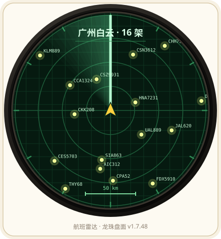 | 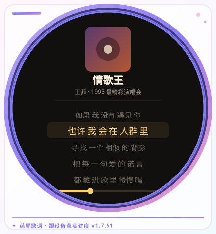 | 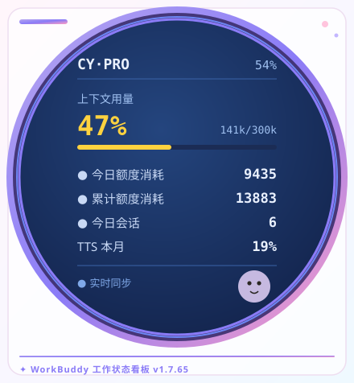 |
| 龙珠盘面，飞机按真实航速移动 | 整版滚动，跟设备真实进度 | 打开即常亮，只读真实字段 |

| 常听电台 | 拍照识别 | 本机/云端主备 |
|:---:|:---:|:---:|
| 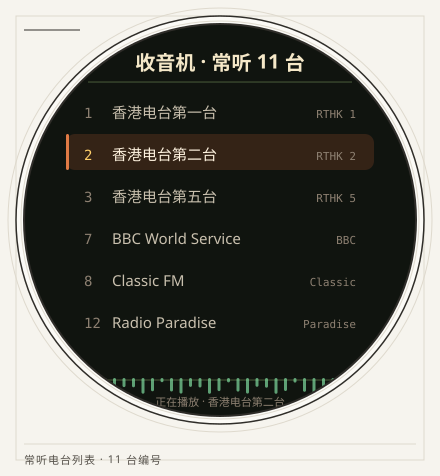 | 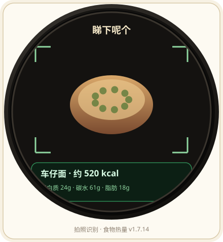 | 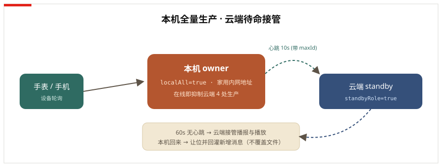 |
| 编号固定，说"第 16 台"永远同一个台 | 拍照后用粤语念出识别结果 | 心跳 10s，60s 无心跳云端接管 |

| 高德路线规划 | WorkBuddy 语音指挥工作流 |
|:---:|:---:|
| 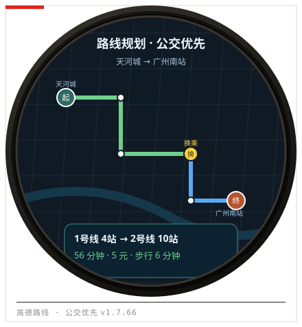 | 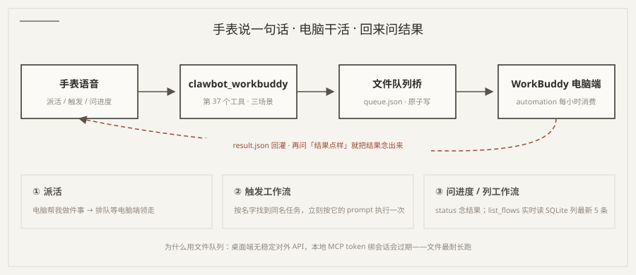 |
| 问路线默认公交优先，念换乘方案 | 手表派活 → 电脑执行 → 结果回灌 |

航空电台点播页（37 个塔台，网页直听或一键推到手表）：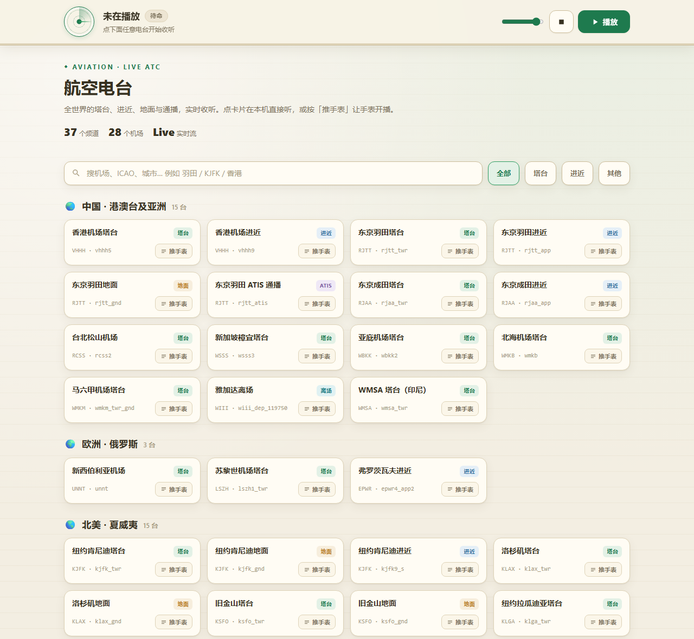

---

## 它能做什么

| 能力 | 触发方式 | 说明 |
|---|---|---|
| 语音问答 | 唤醒词 | 接入 AI 服务端做对话理解，指令类请求会真正调用工具执行 |
| 定时早报 | 每日 **08:00** 准点 | 本地新闻 5 条 + 关注球队新闻 5 条，逐条带正文；前夜预生成 + 预约释放，误差 ≤ 15 秒 |
| 午间快讯 | 每日 **12:00** 自动 | 午间新闻档，白天与夜间自动切换新闻源；源失效会自动换备用源 |
| 晚间本地新闻 | 每日 21:00 自动 | 8 条深度版，约 4.5 分钟；白天与夜间自动切换新闻源 |
| 实时行情 | 语音「XX 多少钱」 | A 股 / 港股，支持公司名、简称、代码三种说法 |
| 天气 | 语音「今天天气」 | 今天与明天，含温度区间与降水 |
| 提醒 / 每日任务 | 语音「几点提醒我」 | 创建、查询、取消，到点推送语音到设备 |
| 音乐播放 | 语音「放首歌」 | 本地曲库检索，支持模糊匹配与歌名纠正 |
| 满屏歌词 | 语音「放首歌」后自动 | 逐句 / 整版滚动，跟设备**真实播放进度**对齐；支持按专辑、演唱会原顺序（setlist）连播，连播自动去重 |
| 消息推送 | 后台 / 微信 | 文字上屏 + 语音播报，设备离线也能补收 |
| 表情与眼神跟随 | 全自动 | 摄像头人脸检测驱动眼睛转向，播报时"看着你讲" |
| 断点续收 | 全自动 | 消息游标机制，重启不重播、断网不丢条 |
| 逐字字幕 | 全自动 | 正文按标点分页，起点按字数摊到音频时长；解码进度 + 墙钟兜底，最多 200 页 |
| 拍照识别 | 语音指令 | 食物热量（结构化营养数据）/ 地点判定（模型只抄字、规则库判地名）；默认走"识万物"，说"看看这食物 / 什么地方"才转推理链路 |
| 智能家居控制 | 语音「开灯」等 | 经本地网关控制灯、空调、窗帘、风扇、插座、电视等 19 类设备，动作 12 类 |
| 家居事件播报 | 全自动 | 门铃、烟感、漏水、门锁、人体感应等 → 自然粤语播报，带防抖与优先级 |
| 实时航班雷达 | 语音「附近有什么飞机」 | 拉实时 ADS-B 数据，按真实航向与距离在圆屏雷达盘面布点，90 秒自动熄灭；中文参数自动 URL 编码 |
| 航空电台 | 语音「听塔台」 | 37 个机场的塔台 / 进近 / 地面频道，说机场名、ICAO 或中文别名都能切；泛称默认常用机场 |
| 工作状态看板 | 语音「打开看板」/「看额度」 | 账号、上下文用量、额度消耗、会话数、TTS 用量，只读真实字段；打开即常亮，说「收起看板」才退出 |
| 路线规划 | 语音「点去白云机场」 | 接高德 Web 服务，**默认公共交通优先**，念换乘线路、站数、时长与票价；明确讲开车/行路才切模式；Key 从配置读、不内置 |
| 语音指挥工作流 | 语音「帮我派活」「执行 XX 工作流」「结果点样」「现在有哪几条工作流」 | 手表经文件队列桥把活派给电脑端 WorkBuddy（automation 每小时消费），结果回灌后再问就念出来；列工作流实时只读本地 SQLite，最新 5 条 |
| 云端托管 | 全自动 | 播放与播报链路可跑在云端；本机心跳断 60 秒后云端接管，本机回来让位并补回新增消息 |
| 常驻角色 | 全自动 | 常驻人设 + 三条声线分工（播报 / 传话 / 对话），18 张待机动图随机轮播 |

> 手表端不使用云端唤醒词服务：唤醒词在设备本地由轻量声学模型识别，断网也能唤醒。

---

## 系统架构

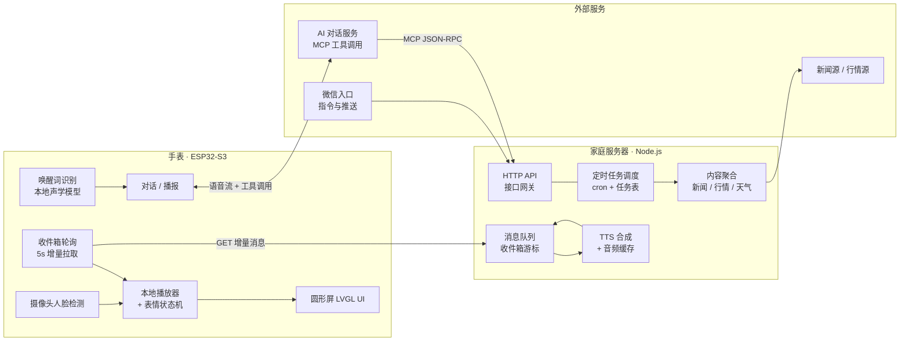

数据流有两条关键路径：

1. **被动对话**：设备唤醒 → 语音上行 → AI 服务端理解 → 若判断为"执行类"意图，通过 **MCP 协议**回调自建服务端的工具（查行情、创建提醒、播新闻）→ 结果返回给模型组织成话术 → 设备播放。
2. **主动播报**：服务端 cron 到点 → 聚合内容 → 合成语音 → 写入收件箱并递增消息游标 → 设备在 5 秒内拉到 → 亮屏开播。

细节见 [docs/architecture.md](docs/architecture.md)。

---

## 技术亮点

### 1. 让"模型会说话"变成"模型会干活"

把自建服务端的 HTTP 能力包装成 **30 多个 MCP 工具**（行情、天气、搜新闻、播新闻、提醒、任务管理、曲库、电台、航班、航空塔台、看板、推送到微信……），工具描述里写死约束：*涉及实时数据必须先调用工具，不得凭记忆作答*。模型说出的股价、天气、航班、新闻全部来自真实接口，从"听起来像"变成"确实是"。

### 2. 唤醒即播：设备不等你喊

收件箱轮询走**白名单状态**（空闲 + 聆听），拉到消息后先把 CPU 与背光从省电档拉回来再播。待机来消息 → **0.4 秒后开口**，全程不用喊唤醒词；断网期间的积压消息在恢复后按序补播。更多状态机细节见 [docs/architecture.md](docs/architecture.md)。

### 3. 双源新闻：白天看图文，夜里看联播

本地新闻两个源按时间切换主源：**白天图文源先手，入夜视频源先手**。同题判定用**去标点后的 2-gram 集合重合度**——标题措辞完全不同也能认出是同一件事；跨源合并用**交替取稿 + 主源配额**，只有日期没有时分的源照样拿到主稿位，正文一条不丢。

### 4. 眼神跟随：一张会看人的脸

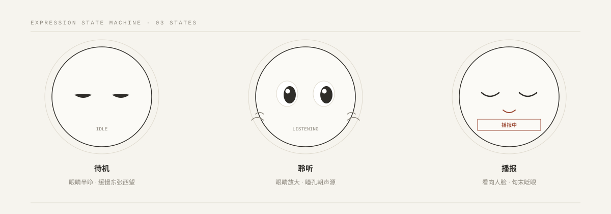

屏幕上的眼睛由状态机驱动：待机、聆听、思考、说话、播报各有一套动作，摄像头人脸检测实时提供朝向。调试注入带 **10 秒超时自动回落**与显式解除命令，人脸数据随时接管，不会把眼睛锁死在某个方向。

### 5. 收件箱游标：重启不重播

设备维护一个 `after` 游标，每次只拉取游标之后的消息，成功投递后推进游标。重启不重播历史播报，断网期间的积压消息按序补收，服务端也不必维护每台设备的会话状态。

### 6. 看门狗：服务挂了自己爬起来

守护进程**查询云端接口拿真实拉取时间**判断设备存活，并为播报留出一段带宽窗口，播报期间绝不误杀。设备常年在线，服务异常可自愈重启。

---

### 7. 字幕是一整条链，不是一个字段

正文分页 → 起点按字数摊到音频时长 → 收件箱 / 云端镜像 / 预约队列全程透传 → 设备解码进度驱动翻页 → 进度卡住时用墙钟接管。横跨服务端与设备的逐字同步，标题和正文都能整版滚动。

### 8. 单通道不丢消息

音乐、电台、新闻、提醒共用一个播放器。调度直接读播放器**真实状态**，起播后确认真的起来了，失败就把稿放回队列——电台长流占道时，新闻照样一句话不落地送出去。

### 9. 把家电状态变成可听的事件

自建服务端与本地网关之间架一层桥：语音控制走工具 → 网关 REST 服务；事件走 5 秒轮询 + webhook 双通道 → 粤语文案 → 统一播报管道。只听门铃、烟感、漏水、门锁、人体、低电量这类值得吵的事件，灯与开关的状态变化一律不播，再加冷却与每分钟上限。

### 10. 播放链路能上云，本机不必 7×24 开着

本机做主控、云端做兜底：本机在线时由本机发指令（延迟低、能读串口状态），**60 秒收不到心跳就由云端接管**；本机恢复后主动让位，并通过「收件箱增量回灌」把云端期间新增的消息补回来（不覆盖文件，避免旧快照盖掉新消息）。多设备、断网、断电都不影响手表开口。

### 11. 实时航班雷达：数据、塔台、气象三合一

ADS-B 的原始数据又大又难读：航向、高度、呼号散在成百上千条报文里，还夹着地面车辆。要做成「抬腕就能看」，得先在服务端滤波——按距离与高度筛出真正在飞的，换算成相对方位与公里数，再投影到圆屏的极坐标盘面上。塔台音频是另一条同源链路：拉到的是**真 MP3 流**而不是网页播放器，所以不需要浏览器，直接转码成设备唯一认的单声道 Ogg Opus。天气用 METAR 报文补起降条件。三个源各自缓存不同时长，避免一分钟打几十次请求。

### 12. 歌词要跟真实进度，不是跟时间戳

把**推流时钟**和**画面时钟**彻底分开：音频按绝对时间锚点推，背压时重置锚点、绝不追赶；歌词位置跟墙钟算，不跟推流算，网络抖动也不跳句。「连续播同一歌手」加「音乐 id + 归一化歌名」双键去重，同一首不会推两遍。

### 13. 屏幕中文零缺字：按需生成专用小字库

项目自带的 `font_*_basic_*` 是给界面用的 **531 字精简子集**，LVGL 遇到没有字形的字符会静默跳过、不画方框、不留空位——看着就像被裁掉。解法是用系统全字库按需生成只含文案的专用小字库（一百多字形、约一百 KB），改文案同步加字重编。附赠一条判断口诀：**留下的字零散随机 → 缺字；缺的是连续一整段 → 才是裁切。**

### 14. 问路线，默认给公交

手表用自己的工具协议直连高德 Web REST，**问路线默认公交优先**，明说开车/行路才切模式。地名先带城市查、落空再全国重查，解决「白云机场」命中贵阳、跨城「北京南站」查不到的歧义；再给一个默认大本营城市用于推起点。接口多种返回结构（数组/对象、字符串票价）统一归一化后播报。

### 15. 让手表指挥电脑：没有 API，就用文件队列

用**本地文件队列**打通手表与电脑端 WorkBuddy：`queue.json` 派活、`result.json` 回灌，原子写、五分钟去重、结果裁到 600 字，状态机 pending / running / done / error；消费端是每小时跑一次的自动化任务。「现在有哪几条工作流」则直接只读打开本地 SQLite（`node:sqlite`），实时列最新 5 条并把 RRULE 翻成中文。手表只负责「说一句」和「听结果」，架构最简也最稳。

---

## 硬件与固件

| 项目 | 说明 |
|---|---|
| 主控 | ESP32-S3，16 MB Flash + 8 MB PSRAM |
| 屏幕 | 1.5 寸圆形触摸屏，480×480 |
| 传感 | 摄像头（人脸检测）、麦克风阵列、扬声器、环境光 |
| 固件框架 | ESP-IDF v6.0 + LVGL |
| 升级方式 | 双 OTA 分区烧写，保留可回滚基线；每次发版记录版本号与回滚路径 |
| 当前版本 | **v1.7.66-lyric-nofreeze**（2026-11-20），首次公开以来共 40 多个固件版本 |

固件改动集中在三块：收件箱轮询与播放调度、表情与眼神状态机、串口调试命令。发布流程固定为「改版本头 → 编译 → 校准版本串 → 备份可回滚镜像 → 台账记录 → 双分区烧写」。

详见 [docs/hardware.md](docs/hardware.md)。

---

## 更新日志

首次公开上架以来（11-03 ~ 11-23），设备侧发了 **40 多个版本**，服务端长出十条能力线（音乐平台、网络电台、逐字字幕、拍照识别、智能家居、实时航班、航空电台、WorkBuddy 看板、高德路线规划、语音指挥工作流）——**每一版都是被真机上的一个具体现象逼出来的**，没有一版是顺手重构。逐版的问题、根因、改法与验证过程见 [docs/firmware-history.md](docs/firmware-history.md)，网页版见[在线展示页](https://marchinlab.github.io/sensecap-watcher-cy/)。

> 最后两条能力线（11-23 的高德路线规划、语音指挥 WorkBuddy 工作流）**没有固件版本号**——都在服务端完成，固件零改动，详见表格下方「服务端更新」一节。

| 版本 | 主题 | 一句话 |
|---|---|---|
| v1.7.0-petfish | 屏幕形象 | 胶囊眼换成 DS 大肥鱼，18 张 GIF + 三方向视觉跟随 |
| v1.7.1-cyclefix | 修三处"像坏了" | 轮播不切换 / 开机闪旧眼 / GIF 是假动画 |
| v1.7.2-blink | 部件级动画 | 背景身体静止，只有眼睛眨、手在摆；体积反而小了 |
| v1.7.3-blinkfix | 闭眼帧重做 | 黑斑、浅色眼罩的根因是标定错位，贴回改自动差异法 |
| v1.7.4-lmusic | 模型答应不干活 | 服务端改串口直发播放指令；顺带发现音频只认单声道 |
| v1.7.5-btnstop | 按了停不住 | 按键改成"只停不开会话"，同一地址去重防止停了又响 |
| v1.7.6-handamp | 手摆调优 | 摆幅分级 ±17° / ±12°；错标在脸颊上的圆圈下线 |
| v1.7.7-nowm | 资产修复 | 清掉一直挂在脸上的生成水印 |
| v1.7.9-textcenter | 状态机 / UI | 换 WiFi 不丢形象；文字居中透明底 |
| v1.7.10-newspriority | 新闻优先 | 播报态也取件；字幕时间轴贯通全链路 |
| v1.7.12-subclock | 进度兜底 | 字幕停第一页 → 墙钟接管，真进度恢复自动切回 |
| v1.7.13-subtext | 数据修复 | 正文分页（原来字幕存的是标题）+ 音量 +30% |
| v1.7.14-voicesnap | 新功能 | 语音指令拍照识别，不用先按一下 |
| v1.7.15-btnfix | 占道根治 | 旋钮停不了电台 / 电台占道吞新闻 |
| v1.7.19-wifilock | 播放稳定性 | 播放期锁住 WiFi 性能档，别偷偷降档卡顿 |
| v1.7.20-cloudplay | 架构升级 | 电台/曲库/新闻全部上云，本机不用 7×24 开机 |
| v1.7.21-camsnap | 拍照修复 | 视觉跟随堵塞串口让拍照失效，加让路标志 |
| v1.7.24-visionfix | 拍照路由 | 工具选对了却被定位模板带偏，三层同修 |
| v1.7.25-dnsota | 假死治理 | DNS 失败让设备半瘫 18 分钟，静态 DNS + 只检查不安装 |
| v1.7.27/28-pollguard/playguard | 看门狗 | 根治不取件假死，又修好看门狗误杀正常播放 |
| v1.7.45/46-radar | 新能力 | 实时航班雷达上线：ADS-B 数据 + 动态外推 + 扫描盘面 |
| v1.7.47-radar-refine | 雷达精修 | 加 12 根方位刻度、扫描线加粗、飞机改圆点、航班号换小字体 |
| v1.7.48-dragonball-radar | 龙珠盘面 | 换深绿方格网 + 黄光点 + 中心指向三角 + 50km 比例尺，扫描线全删 |
| v1.7.49-lyrics-fullscreen | 歌词铺满 | 卡片 340px→404×404 铺满圆屏、歌词区 72→200px；中间那块空白是"200px 只画一行" |
| v1.7.50-lyrics-scroll | 整版滚动 | 5 行窗口逐句上滑 220ms、标题双 label 叠印伪粗体；描边抢 CPU 致卡顿 → 改静态截断 |
| v1.7.51-lyrics-device-clock | 跟真实进度 | 用 I2S 同源 pos + 200ms 本地时钟切句，字幕滞后 1~2 秒 → 约 130ms |
| v1.7.52-wifi-rx-stream | 卡顿取证 | 建连 3043ms 而服务端推流 100% 实时 → 病根在接收端；WiFi 缓冲 3/6→6/16 + 播歌关省电，建连降到 10ms |
| v1.7.53-lyric-window12 | 歌词冻住 | 窗口只有 6 句、推完 4 句就停 → 12 句 + 按 lag 平移对齐 + 文本相同时仍补时间轴 |
| v1.7.54-memfix | OOM 重启 | "第二首没歌词"实为内存耗尽重启：缓冲回退 3/6、socket 10→16、内存闸门 <12KB 跳过轮询、切歌重置窗口 |
| v1.7.55-workbuddy-board | 新看板 | 蓝发女仆鲸鱼娘 + 真实账号/上下文/额度/TTS；三轮修主题字体在 Create 阶段缓存导致的 PC=0 崩溃 |
| v1.7.56-circle-board | 圆形底板 | 蓝板 344×300→412 正圆、信息收进圆内安全竖条、底部提示提亮 |
| v1.7.57/58-cjk-fix | 中文竖排 | 主题 CJK 行高实测 43px > 手算 26px → 按真实行高重排，9 行合并 4 行 |
| v1.7.59-board-left | 左对齐 | 行距改 line_h+3、全部左对齐、Q 版挪右下 |
| v1.7.60-flex-smallfont | 回 flex | 弃手算绝对定位，回 flex 自动堆叠 + 20px 小中文字体 |
| v1.7.61-board-nocut | 裁字 / 透出 | 删 LONG_DOT 改自适应宽度、底板改全不透明遮住 Listening |
| v1.7.62-board-foreground | 被盖住 | 看板其实一直在刷，只是被 listening 层盖住 → timer 每秒强制置顶（不是透明度问题） |
| v1.7.63-board-linewidth | 吞开头 | 真因：无宽度 label 在 flex 里从左侧裁 → 固定 310 + LONG_CLIP |
| v1.7.64-board-abs-layout | 弃 flex | 固定 324×25 + 绝对定位 + 显式 text_align=LEFT，flex 只管高度 |
| v1.7.65-board-fullfont | 字库缺字 | 前四版全改错方向：basic 字库只收 531 字、LVGL 缺字静默跳过 → 全字库生成 font_wb_20 |
| v1.7.66-lyric-nofreeze | 歌词冻住 | 内存闸门从"<12KB 直接跳过轮询"改成降频不断供（≥12K 每 2s / 9~12K 每 8s / <9K 跳过） |

### 服务端更新（无固件版本号）

| 日期 | 能力 | 具体做了什么 |
|---|---|---|
| 11-23 | 高德路线规划 | 新增 `clawbot_route`（第 36 个工具）直连高德 REST，**问路线默认公交优先**，明确讲开车/行路才切模式；地名先带城市查、落空再全国重查；公交接口报 `10002` 曾误判「没开通权限」，真因是路径漏了 `direction/` |
| 11-23 | 语音指挥工作流 | 新增 `clawbot_workbuddy`（第 37 个工具）+ 文件队列桥，手表可派活 / 触发工作流 / 问进度；「现在有哪几条工作流」实时只读本地 SQLite 列最新 5 条，把 RRULE 翻成中文 |

两条都在服务端完成，**固件零改动**；细节见展示页「服务端之六 / 之七」两章。

其中 **11-19 的看板十一版**是一次典型的排查公开课：前四版一直以为中文"少字"是排版裁切，改 flex、改宽度、改坐标都没用，最后才发现是项目字库只收了 500 多个常用字，缺的字被静默跳过。详见 [更新日志](docs/firmware-history.md) 第 19 章。

发版纪律固定为：**改版本头 → 编译 → 校验产物里的版本串 → 备份可回滚镜像 → 台账记录 → 双分区烧写**。

### 待机表情图鉴

手表屏幕上实际轮播的 18 张表情（每张 12 帧 / 90ms，眨眼 + 分级手摆），动图版见项目主页，源图在 [assets/petfish/](assets/petfish/)：

| # | 表情 | # | 表情 | # | 表情 |
|---|---|---|---|---|---|
| 01 | 商场挥手 | 07 | 雪山捧脸 | 13 | 樱花浅笑 |
| 02 | 咖啡馆比 V ★ | 08 | 夜市叹气 | 14 | 海边耳机 |
| 03 | 游乐园气球 | 09 | 教室看书 | 15 | 城堡问号 |
| 04 | 樱花捂脸 | 10 | 商店街吃面 | 16 | 雪地吹气 |
| 05 | 海滩欢呼 | 11 | 窗边抱膝 | 17 | 夜街眨眼 |
| 06 | 城堡前惊讶 | 12 | 摩天轮下 | 18 | 操场挥手 |

★ = v1.7.6 里卸掉手摆的那张（圆圈原本错标在脸颊上）；08 / 11 / 15 是手贴围裙的帧，摆幅收敛到 ±12°。

### 待机动图

表上实际轮播的 18 张动图（见 [assets/petfish/](assets/petfish/)）——每张都是 12 帧 / 90ms 的部件级动画，背景身体静止、只有眼睛眨和手在摆：

     
     
     

---

## 服务端

单进程 Node.js，无数据库依赖（任务与消息落 JSON 文件 + 云端同步），模块划分：

- **接口网关**：设备拉取/上报、管理页、MCP 端点
- **定时调度**：cron 管理 + 每日任务表，支持按设备侧/云端侧分工执行
- **内容聚合**：多源新闻抓取、去重、正文抽取、行情与天气
- **语音**：TTS 合成与音频缓存，长文本分段
- **消息队列**：收件箱游标、24 小时自动清理、预约队列（准点释放）
- **视觉识别**：拍照上传 → 视觉模型 → 结构化结果 / 规则库判定 → 统一播报管道
- **智能家居桥接**：网关 REST、别名解析、动作归一、5 秒状态轮询、webhook 事件、粤语文案与防抖

详见 [docs/features.md](docs/features.md)。

---

## 演示

| 素材 | 内容 | 状态 |
|---|---|---|
| 早报播报实拍 | 9:00 自动亮屏、开口、逐条播报 | 待补 |
| 表情跟随录屏 | 人在镜头前左右移动，眼睛同步转向 | 待补 |
| 语音查行情 | 说出公司名，返回实时价格与涨跌幅 | 待补 |
| 管理页截图 | 任务表、消息队列、设备状态（脱敏版） | 待补 |
| 待机动图 | 18 张待机动图（部件级眨眼 + 手摆） | 已上线（见上方） |

素材涉及设备实拍与界面截图，需逐项打码后再公开，因此暂不随仓库提供。

---

## 关于这个仓库

这是一个**展示仓库**，用于说明项目做了什么、怎么设计的、踩过哪些坑。

- **不含业务源码**：固件与服务端的实现代码保留在私有仓库中。
- **不含任何凭据与部署信息**：域名、密钥、设备标识、服务器地址均已移除。
- 架构图、时序说明、技术取舍均为真实实现的抽象描述。

如果你想讨论实现细节、复刻思路，或者想让我在某个具体环节展开，欢迎开 Issue。

---

## Roadmap

- [x] 本地自然粤语声线（角色传话 / 提醒 / 闲聊）
- [x] 拍照识别食物热量与地点
- [x] 智能家居语音控制与事件播报（本地网关桥接）
- [ ] 门铃 / 传感器事件的真机端到端实测
- [ ] 蓝牙传感器经代理接入（人体存在、门磁）
- [ ] 美股与指数行情
- [ ] 多设备协同（桌面 + 随身）
- [ ] 语音日程与日历双向同步
- [ ] 本地语音指令热词自定义

---

## License

文档与图表采用 [CC BY-NC-SA 4.0](LICENSE)，可自由阅读、引用与二次演绎，保留署名且不得用于商业用途。
