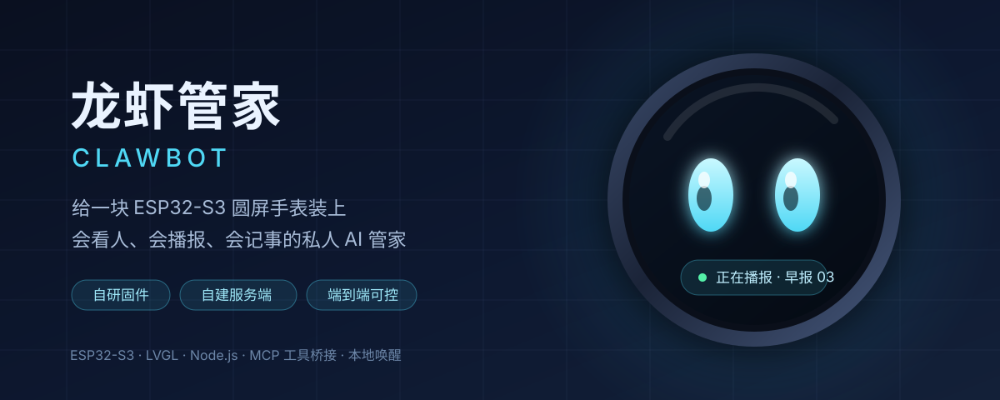
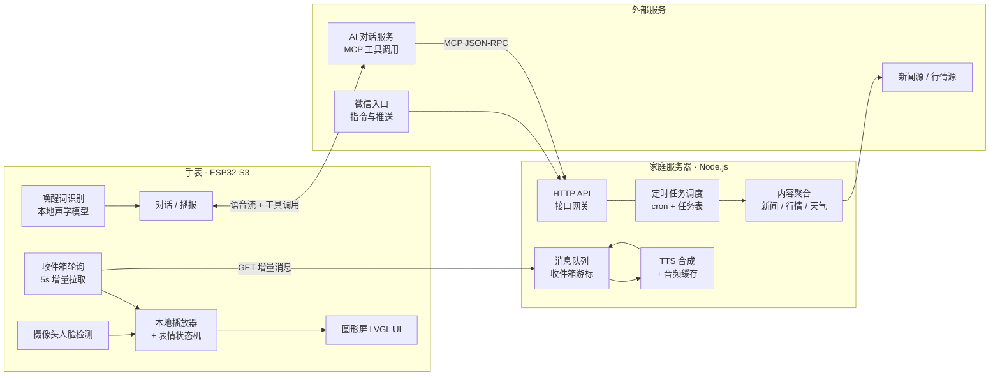
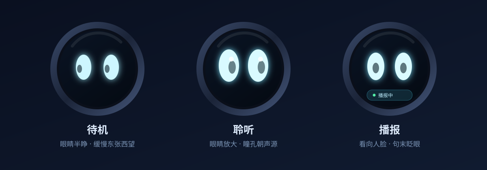

# SenseCAP Watcher · CY 定制版

**给一块 ESP32-S3 圆屏手表装上"会看人、会播报、会记事"的私人 AI 管家**

自研固件 + 自建服务端 · 端到端跑在自己的设备上

个人项目 · 展示页（不含业务源码）

---

## 这是什么

一块 Seeed **SenseCAP Watcher**（ESP32-S3，1.5 寸圆形触摸屏，带摄像头），刷上自研固件后接入自建的家庭服务器，变成一个**每天主动开口的桌面管家**：

- 早上 9 点自己播当天早报，晚上 9 点播本地新闻，播的时候屏幕会亮、眼睛会转向你
- 你随口问"某某股票多少钱"，它当场查实时行情念出来，不是凭记忆瞎编
- 你说"明天七点叫我"，它记住并在到点时推送语音提醒到手表上
- 手表的表情会随状态变化：待机时东张西望，说话时看向你，播报结束眯眼笑

整条链路上**没有第三方订阅、没有云厂商锁定**：固件在自己手上编译，服务端是自己写的 Node 进程，跑的是一台家用机器。

---

## 它能做什么

| 能力 | 触发方式 | 说明 |
|---|---|---|
| 语音问答 | 唤醒词 | 接入 AI 服务端做对话理解，指令类请求会真正调用工具执行 |
| 定时早报 | 每日 9:00 自动 | 本地新闻 5 条 + 关注球队新闻 5 条，逐条带正文，约 3 分钟 |
| 晚间本地新闻 | 每日 21:00 自动 | 8 条深度版，约 4.5 分钟；白天与夜间自动切换新闻源 |
| 实时行情 | 语音「XX 多少钱」 | A 股 / 港股，支持公司名、简称、代码三种说法 |
| 天气 | 语音「今天天气」 | 今天与明天，含温度区间与降水 |
| 提醒 / 每日任务 | 语音「几点提醒我」 | 创建、查询、取消，到点推送语音到设备 |
| 音乐播放 | 语音「放首歌」 | 本地曲库检索，支持模糊匹配与歌名纠正 |
| 消息推送 | 后台 / 微信 | 文字上屏 + 语音播报，设备离线也能补收 |
| 表情与眼神跟随 | 全自动 | 摄像头人脸检测驱动眼睛转向，播报时"看着你讲" |
| 断点续收 | 全自动 | 消息游标机制，重启不重播、断网不丢条 |

> 手表端不使用云端唤醒词服务：唤醒词在设备本地由轻量声学模型识别，断网也能唤醒。

---

## 系统架构

数据流有两条关键路径：

1. **被动对话**：设备唤醒 → 语音上行 → AI 服务端理解 → 若判断为"执行类"意图，通过 **MCP 协议**回调自建服务端的工具（查行情、创建提醒、播新闻）→ 结果返回给模型组织成话术 → 设备播放。
2. **主动播报**：服务端 cron 到点 → 聚合内容 → 合成语音 → 写入收件箱并递增消息游标 → 设备在 5 秒内拉到 → 亮屏开播。

细节见 [docs/architecture.md](docs/architecture.md)。

---

## 技术亮点

### 1. 让"模型会说话"变成"模型会干活"

早期版本里，问股票只能得到模型编造的数字 —— 因为对话服务端**手里没有任何工具**。后来把自建服务端的 HTTP 能力包装成 **11 个 MCP 工具**（行情、天气、搜新闻、播新闻、提醒、任务管理、曲库、推送到微信……），并在工具描述里写死约束：*涉及实时数据必须先调用工具，不得凭记忆作答*。这才从"听起来像"变成"确实是"。

### 2. 唤醒即播：设备不等你喊

原本固件只在退到空闲态时才轮询收件箱，结果设备停在"聆听"或进入省电降频后**再也收不到新消息**，表现为"明明推了却不开腔"。

改法是双管齐下：轮询状态从"只认空闲"放宽成**白名单**（空闲 + 聆听），拉到消息后先把 CPU 与背光从省电档拉回来再播。第一版用黑名单排除，结果开机早期网络栈未就绪就去发请求，触发协议栈断言、2.5 秒一次无限重启 —— 这类状态判断**必须用白名单**，这是踩出来的教训。

现在：待机来消息 → **0.4 秒后开口**，全程不用喊唤醒词。

### 3. 双源新闻：白天看图文，夜里看联播

本地新闻有两个源：一个是图文站，更新勤、有完整正文；另一个是视频平台，晚间联播是视频稿，只有一句话简介。

按时间切换主源：**白天图文源先手，入夜后视频源先手**。还有两个细节：

- 两个源经常报同一件事，标题措辞完全不同（"3 日起索道停运约 45 天" vs "11 月 3 日起索道停运，恢复时间待定"）。比前缀抓不到，改用**去掉标点后的 2-gram 集合重合度**判定同题，重合度超阈值即视为同一条。
- 跨源合并时若纯按时间戳排序，只有日期没有时分的源会被系统性挤到末尾，正文全丢、播报字数从 1400 掉到 500。解决办法是**交替取稿 + 主源配额**，而不是简单排序。

### 4. 眼神跟随：别让一次调试把眼睛焊死

屏幕上的眼睛由状态机驱动：待机、聆听、思考、说话、播报各有一套动作，摄像头人脸检测提供朝向。

曾经有个不易察觉的坑：手动注入一次"看向左边"的调试指令后，眼睛**再也回不到跟随模式**，因为注入逻辑把"外部接管"标记永久置位，人脸数据被提前拦截。修法是给注入加 **10 秒超时自动回落**，并提供显式解除命令。排查过程靠的是在播报中用串口逐条切换表情做对照实验，把"渲染坏了""显示冻结""逻辑没跑"三种可能逐个排除。

### 5. 收件箱游标：重启不重播

设备维护一个 `after` 游标，每次只拉取游标之后的消息，成功投递后推进游标。好处是：重启不重播历史播报，断网期间的积压消息在恢复后按序补收，服务端也不必维护每台设备的会话状态。

### 6. 看门狗：别把"设备没拉消息"当成"服务挂了"

守护进程会检查设备最近一次拉取时间。但设备后来改成直接从云端拉取，守护进程查本地计数就永远"停更"，于是误判并反复重启服务。修法是让守护进程**查询云端接口拿真实拉取时间**，并保留一个播音频宽窗口，避免播报中被误杀。

---

## 硬件与固件

| 项目 | 说明 |
|---|---|
| 主控 | ESP32-S3，16 MB Flash + 8 MB PSRAM |
| 屏幕 | 1.5 寸圆形触摸屏，480×480 |
| 传感 | 摄像头（人脸检测）、麦克风阵列、扬声器、环境光 |
| 固件框架 | ESP-IDF v6.0 + LVGL |
| 升级方式 | 双 OTA 分区烧写，保留可回滚基线；每次发版记录版本号与回滚路径 |

固件改动集中在三块：收件箱轮询与播放调度、表情与眼神状态机、串口调试命令。发布流程固定为「改版本头 → 编译 → 校准版本串 → 备份可回滚镜像 → 台账记录 → 双分区烧写」。

详见 [docs/hardware.md](docs/hardware.md)。

---

## 更新日志

首次公开上架以来，设备侧发了 7 个版本，服务端长出两条能力线（自建音乐平台、网络电台）——**每一版都是被真机上的一个具体现象逼出来的**，没有一版是顺手重构。逐版的问题、根因、改法与验证过程见 [docs/firmware-history.md](docs/firmware-history.md)，网页版见项目主页。

| 版本 | 主题 | 一句话 |
|---|---|---|
| v1.7.0-petfish | 屏幕形象 | 胶囊眼换成鲸鱼娘全身像，18 张 GIF + 三方向视觉跟随 |
| v1.7.1-cyclefix | 修三处"像坏了" | 轮播不切换 / 开机闪旧眼 / GIF 是假动画 |
| v1.7.2-blink | 部件级动画 | 背景身体静止，只有眼睛眨、手在摆；体积反而小了 |
| v1.7.3-blinkfix | 闭眼帧重做 | 黑斑、浅色眼罩的根因是标定错位，贴回改自动差异法 |
| v1.7.4-lmusic | 模型答应不干活 | 服务端改串口直发播放指令；顺带发现音频只认单声道 |
| v1.7.5-btnstop | 按了停不住 | 按键改成"只停不开会话"，同一地址去重防止停了又响 |
| v1.7.6-handamp | 手摆调优 | 摆幅分级 ±17° / ±12°；错标在脸颊上的圆圈下线 |

发版纪律固定为：**改版本头 → 编译 → 校验产物里的版本串 → 备份可回滚镜像 → 台账记录 → 双分区烧写**。

### 待机表情图鉴

手表屏幕上实际轮播的 18 张表情（每张 12 帧 / 90ms，眨眼 + 分级手摆），动图版见项目主页，源图在 [assets/petfish/](assets/petfish/)：

| # | 表情 | # | 表情 | # | 表情 |
|---|---|---|---|---|---|
| 01 | 商场挥手 | 07 | 雪山捧脸 | 13 | 樱花浅笑 |
| 02 | 咖啡馆比 V ★ | 08 | 夜市叹气 | 14 | 海边耳机 |
| 03 | 游乐园气球 | 09 | 教室看书 | 15 | 城堡问号 |
| 04 | 樱花捂脸 | 10 | 商店街吃面 | 16 | 雪地吹气 |
| 05 | 海滩欢呼 | 11 | 窗边抱膝 | 17 | 夜街眨眼 |
| 06 | 城堡前惊讶 | 12 | 摩天轮下 | 18 | 操场挥手 |

★ = v1.7.6 里卸掉手摆的那张（圆圈原本错标在脸颊上）；08 / 11 / 15 是手贴围裙的帧，摆幅收敛到 ±12°。

---

## 服务端

单进程 Node.js，无数据库依赖（任务与消息落 JSON 文件 + 云端同步），模块划分：

- **接口网关**：设备拉取/上报、管理页、MCP 端点
- **定时调度**：cron 管理 + 每日任务表，支持按设备侧/云端侧分工执行
- **内容聚合**：多源新闻抓取、去重、正文抽取、行情与天气
- **语音**：TTS 合成与音频缓存，长文本分段
- **消息队列**：收件箱游标、24 小时自动清理

详见 [docs/features.md](docs/features.md)。

---

## 演示

| 素材 | 内容 | 状态 |
|---|---|---|
| 早报播报实拍 | 9:00 自动亮屏、开口、逐条播报 | 待补 |
| 表情跟随录屏 | 人在镜头前左右移动，眼睛同步转向 | 待补 |
| 语音查行情 | 说出公司名，返回实时价格与涨跌幅 | 待补 |
| 管理页截图 | 任务表、消息队列、设备状态（脱敏版） | 待补 |

素材涉及设备实拍与界面截图，需逐项打码后再公开，因此暂不随仓库提供。

---

## 关于这个仓库

这是一个**展示仓库**，用于说明项目做了什么、怎么设计的、踩过哪些坑。

- **不含业务源码**：固件与服务端的实现代码保留在私有仓库中。
- **不含任何凭据与部署信息**：域名、密钥、设备标识、服务器地址均已移除。
- 架构图、时序说明、技术取舍均为真实实现的抽象描述。

如果你想讨论实现细节、复刻思路，或者想让我在某个具体环节展开，欢迎开 Issue。

---

## Roadmap

- [ ] 美股与指数行情
- [ ] 设备端离线语音合成（弱网下的播报兜底）
- [ ] 多设备协同（桌面 + 随身）
- [ ] 语音日程与日历双向同步
- [ ] 本地语音指令热词自定义

---

## License

文档与图表采用 [CC BY-NC-SA 4.0](LICENSE)，可自由阅读、引用与二次演绎，保留署名且不得用于商业用途。
