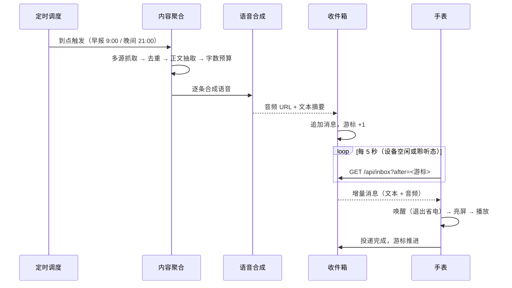
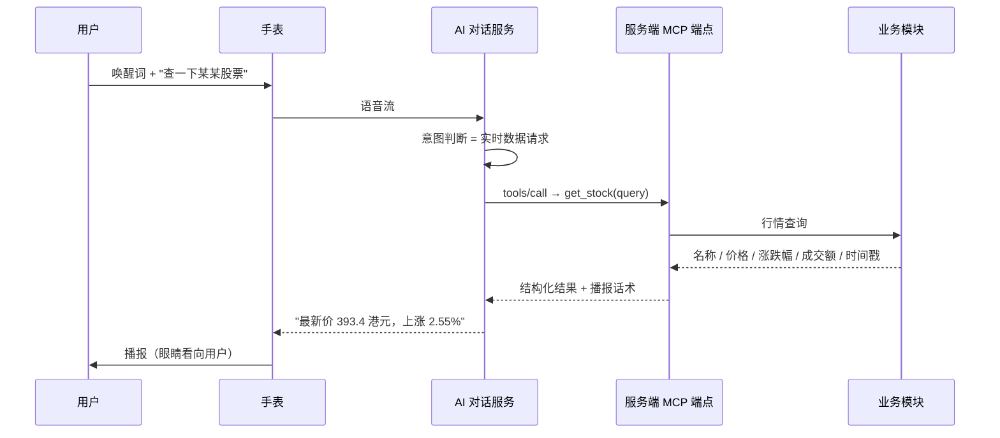

# 架构说明

## 1. 拓扑

```
┌──────────────────────────┐        ┌───────────────────────────┐        ┌────────────────────┐
│  手表（ESP32-S3）         │        │  家庭服务器（Node.js）      │        │  外部服务            │
│                          │        │                           │        │                    │
│  唤醒词识别（本地）        │  语音   │  /api/inbox    消息拉取    │        │  AI 对话服务        │
│  音频上行 / 下行 ─────────┼───────►│  /api/inbox-push 消息写入  │◄──────►│  （MCP 工具调用）    │
│  收件箱轮询（5s） ────────┼───────►│  /api/mcp      MCP 端点    │        │                    │
│  LVGL 圆屏 UI             │        │  /api/jobs     定时任务     │        │  新闻源 / 行情源     │
│  表情状态机 + 人脸检测     │        │  /admin        管理页       │◄──────►│  微信入口            │
└──────────────────────────┘        └───────────────────────────┘        └────────────────────┘
```

职责边界：

- **设备**只负责"被唤醒、说、听、看、显示"，不做任何内容加工，也不持有第三方凭据。
- **服务端**负责所有需要网络与算力的部分：内容聚合、语音合成、任务调度、工具执行。
- **AI 服务端**只负责自然语言理解与话术组织，需要事实与动作时回调服务端的 MCP 工具。

这种切分的直接收益是：换 AI 服务商、换新闻源、换语音引擎，都不需要重新烧固件。

---

## 2. 主链路一：主动播报



关键设计：

- **游标在设备侧**：服务端不保存每台设备的会话状态，扩容与重启都无感。
- **拉取而非推送**：设备处于 NAT 后，长连接维护成本高；5 秒轮询在局域网与公网都可接受，配合本地缓存，延迟实测 5 秒内。
- **投递即时确认**：设备真正开始播放后才推进游标，避免"拉到但不播"导致消息丢失。

---

## 3. 主链路二：语音指令



**为什么必须走工具调用**：模型自身没有实时行情，若不提供工具，它会给出看似合理的编造数字。工具的价值不只是"能查"，还包括在返回值里附上"直接照念、不要改写数字"的约束，降低模型自由发挥的空间。

工具清单（11 个）：

| 工具 | 作用 |
|---|---|
| `remind` | 一次性提醒 |
| `schedule_daily` | 每日定时任务 |
| `list_tasks` / `cancel_task` | 查询与取消 |
| `search_news` / `play_news` | 新闻检索与播报推送 |
| `get_stock` | 实时行情（A 股 / 港股） |
| `get_weather` | 天气 |
| `play_music` / `list_music` | 曲库与播放 |
| `notify_wechat` | 推送到微信 |

---

## 4. 消息模型

一条收件箱消息的最小结构：

| 字段 | 说明 |
|---|---|
| `id` | 递增序号，兼作游标 |
| `text` | 上屏文本（过长时截断，仅作预览） |
| `audio` | 语音地址（服务端合成后落盘） |
| `source` | 来源标识，便于排查 |
| `ts` | 生成时间 |

清理策略：投递后保留 24 小时，避免长期占用存储，同时给出排查窗口。

---

## 5. 设备状态机

```
 启动 ──► 配网 ──► 空闲 ◄──► 聆听 ──► 思考 ──► 说话 ──► 空闲
                    │                          │
                    └──► 播报（Notifying）◄────┘
                    │
                    └──► 升级 / 故障（不轮询收件箱）
```

轮询只在**白名单状态**（空闲、聆听）下进行。原因见 [技术亮点第 2 条](../README.md#2-唤醒即播设备不等你喊)：开机早期网络栈尚未就绪，此时发起请求会触发协议栈断言。

表情与眼神的优先级：**手动调试注入 > 播报状态 > 对话状态 > 待机默认**，注入带 10 秒超时自动回落，避免调试动作永久覆盖跟随行为。

---

## 6. 部署形态

- 服务端跑在一台常开的家用机器上，单进程 + 系统服务守护，崩溃自动拉起。
- 同时保留一个云端实例承担微信入口与外部回调；设备实际只从**其中一侧**拉取消息，避免双写造成重复播报。
- 定时任务分"设备侧执行"与"云端侧执行"两类，由任务定义里的执行侧字段决定，防止同一任务被两个实例重复触发。

> 本仓库不提供部署脚本与地址，相关配置在私有仓库中。
