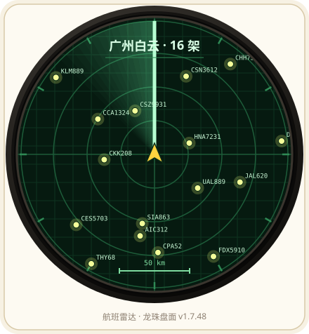
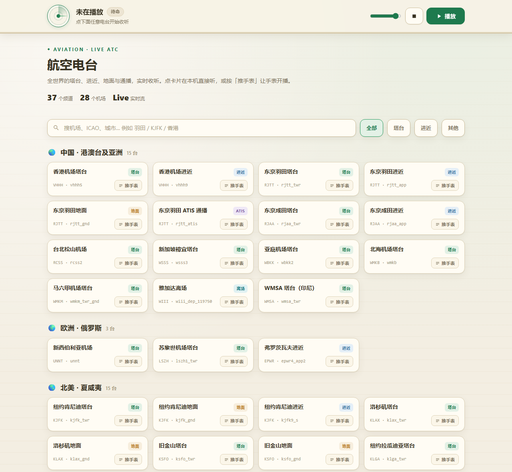
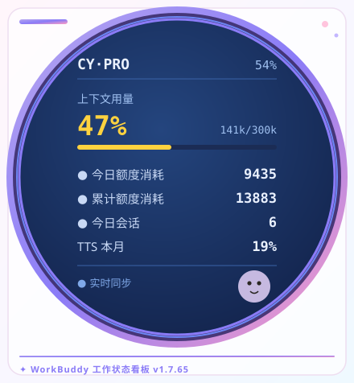
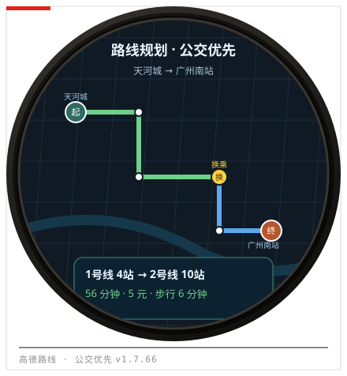
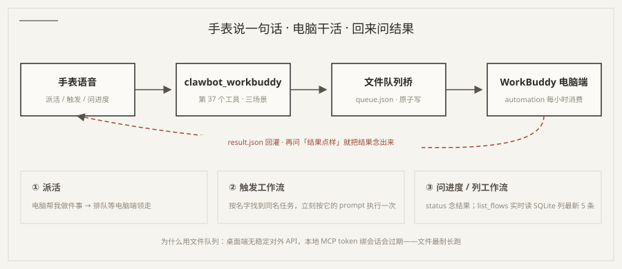

# 更新日志 · 固件与服务端

从项目**首次公开上架 GitHub**（2026-11-03）到现在的更新记录：设备侧逐版记版本号，服务端记八条能力线（音乐、电台、逐字字幕、拍照识别、智能家居、实时航班、航空电台、WorkBuddy 看板）。每一段都写清：为什么改、根因是什么、改了什么、怎么验证的、踩了哪些坑。

时间跨度约两周（11-03 ~ 11-20），设备侧发了 **40 多个版本**——因为每一版都是被真机上的一个具体现象逼出来的，没有一版是"顺手重构"。前半段（第 1~15 章）是公开头三天的形象与播报链路，后半段（第 16~20 章）是随后两周的云端化、拍照、雷达歌词与看板。

---

## 0. 起点：首次公开时的固件

公开那一版设备上跑的是 **v1.6.3-wakeplay**，它本身也是一次事故的产物：

| 版本 | 状态 | 说明 |
|---|---|---|
| v1.6.2-wakeplay | ❌ 作废 | 轮询状态判断用了**黑名单**（"不在这些状态就都拉"），开机早期 `Unknown/Starting` 被放行，lwip 未就绪就去建 HTTP 连接 → 断言失败，**2.5 秒一次无限重启** |
| v1.6.3-wakeplay | ✅ 基线 | 改回**白名单**（idle + listening），其余沿用 v1.6.2 的设计意图：收到消息先唤醒 CPU 与背光，轮询周期 6s → 5s |

v1.6.3 确立的核心能力是"**来消息自己开口**"：串口实测从拿到消息到起播 **0.4 秒**，设备待机时也会自动亮屏播报，不需要喊唤醒词。

> 这条白名单教训后来反复被引用：**涉及网络调用的状态判断必须用白名单，不能用排除法。** 黑名单永远会漏掉某个你还不知道的状态。

---

## 版本一览

| # | 版本 | 日期 | 主题 | 类型 |
|---|---|---|---|---|
| 1 | v1.7.0-petfish | 11-04 | 屏幕形象换成 DS 大肥鱼 | 形象重构 |
| 2 | v1.7.1-cyclefix | 11-04 | 修轮播不切换 / 开机闪旧眼 / GIF 假动画 | bugfix |
| 3 | v1.7.2-blink | 11-04 | 待机动画改部件级：眨眼 + 手摆 | 新功能 |
| 4 | v1.7.3-blinkfix | 11-04 | 闭眼帧重做、贴回算法换自动差异法、摆幅加大 | bugfix |
| 5 | v1.7.4-lmusic | 11-04 | 串口直发播放指令，绕开"模型答应不干活" | 架构性修复 |
| 6 | v1.7.5-btnstop | 11-04 | 旋钮单击＝停播，去重防"停了自己又响" | 交互修复 |
| 7 | v1.7.6-handamp | 11-04 | 手摆分帧幅度；错标在脸上的圆圈下线 | 参数调优 |
| 8 | v1.7.7-nowm | 11-04 | 清掉一直挂在脸上的生成水印 | 资产修复 |
| 9 | v1.7.9-textcenter | 11-04 | 换 WiFi 不丢形象；文字居中透明底 | 状态机 / UI |
| 10 | v1.7.10-newspriority | 11-04 | 新闻优先于音乐；字幕时间轴贯通 | 架构性修复 |
| 11 | v1.7.12-subclock | 11-05 | 字幕停第一页：墙钟兜底 | 进度兜底 |
| 12 | v1.7.13-subtext | 11-05 | 正文分页（原来字幕存的是标题） | 数据修复 |
| 13 | v1.7.14-voicesnap | 11-05 | 语音指令拍照识别 | 新功能 |
| 14 | v1.7.15-btnfix | 11-05 | 旋钮停不了电台 / 电台占道吞新闻 | 占道根治 |
| 15 | v1.7.20-cloudplay | 11-06 | 播放与播报上云，本机/云端主备 | 架构 |
| 16 | v1.7.21~24 | 11-09 | 拍照被堵死 + 定位模板误用 | 拍照线 |
| 17 | v1.7.25~28 | 11-09~10 | DNS 假死 + 看门狗掐播 | 假死治理 |
| 18 | v1.7.45~48 | 11-17 | 实时航班雷达（动态扫描 → 龙珠盘面） | 新能力 |
| 19 | v1.7.49~54 | 11-18 | 满屏歌词整版滚动 + 跟真实进度 + 卡顿取证 | 音乐线 |
| 20 | v1.7.55~65 | 11-19 | WorkBuddy 工作状态看板（十一版调一块屏） | 新功能 |
| 21 | v1.7.66 | 11-20 | 歌词卡住：内存闸门改降频不断供 | 稳定性 |

---

## 1. v1.7.0-petfish：把"胶囊眼"换成 DS 大肥鱼

**现象**　待机界面是一对 LVGL 画的胶囊形眼睛，演示时很难让人一眼看出"这是一个有形象的角色"。

**改法**
- 18 张 412×412 全屏 GIF（`pet_fish/fish_01..18.gif`），由 AI 垫参考图生成，形象统一：深蓝渐变长卷发少女，不同表情 + 不同场景背景（咖啡馆 / 游乐园 / 樱花树 / 海滩 / 城堡 / 雪山 / 学校…）
- 打包脚本 `petfish_pack.py`：抹掉右下角"AI 生成"水印 → 缩放到 412 → 早期版本做 2 帧"呼吸浮动"
- 待机每 5 秒换一张，Fisher-Yates 洗牌抽样（18 张全露脸才可能重复）
- 18 张图按**图中眼睛朝向**分池（左 6 / 中 6 / 右 6），播报时按摄像头人脸位置切对应方向的图——形象换了，视觉跟随没丢
- `mood` 映射沿用：思考→托腮、开心→比耶、跳舞→戴耳机、出错→问号、犯困→抱玩偶

**踩坑**　水印覆盖第一版用了"水印左侧的地面块"，结果把角色的鞋子复制到了右下角——**18 张图每张都多出一双孤立的小黑鞋**。改成用"水印正上方"的地面块才接得上纹理。

**代价**　资源分区 5.49MB → 9.06MB（分区 14MB，还有余量）。

---

## 2. v1.7.1-cyclefix：三个"看起来像坏了"的问题

真机实测反馈三件事，其实对应三个不同的 bug。

**① 待机永远停在同一张图**
`PetApplyMood()` 里 `pet_idle_ms_ = 0` 写在了 idle 判定**之前**，每个 tick（33ms）都先清零再累加，永远到不了 5000ms 的换图阈值。改法是只在"确实离开待机"（mood 被锁定 / 非 idle）时才清零。

**② 每次开机先闪一下上一版的胶囊眼**
assets 加载有约 5 秒空窗，原实现拿胶囊眼顶着，用户开机第一眼看到的是旧形象。改成空窗期压住表情层，assets 一就绪立刻换鱼；重试从 5 秒一次改 1 秒一次，连续 8 次失败才兜底回落胶囊眼（防止真黑屏）。

**③ GIF 是"假动画"**
原 2 帧版本的帧间差异平均只有 0.13，人眼根本看不出在动，观感就是一张静止图。重做成 6 帧 / 150ms：角色上下浮动 ±6px + 左右摆 ±4px（错相），裙摆和头发按高度做剪切飘动，**背景完全静止**。

**踩坑**　PIL 存 GIF 每帧都是全量帧，8 帧全画面动要 9~15MB，直接把 14MB 分区写爆。结论：**必须让背景不动**，只有角色带变化，LZW 才压得下去（264KB/张）。

---

## 3. v1.7.2-blink：从"整体浮动"到"部件级动画"

**反馈**　6 帧整体浮动"人眼看起来有卡顿"，要的是"人物眼睛和手在动"，不是整幅图一上一下。

**改法**　背景与身体完全静止，只有两个部件动：

- **眨眼**：每张底图用图生图生成"闭眼微笑"变体（17 张，`input_fidelity=high`），cv2 模板匹配对齐两图眼位 → 把闭眼版的眼周椭圆羽化贴回原图 = 闭眼帧。14 帧 / 90ms（≈11fps），第 10 帧全闭，约 1.26 秒眨一次
- **手摆**：8 张有独立手臂的（挥手 / 比耶 / 叉腰 / 摊手 / 举书…），以腕部为轴把手部圆圈旋转 ±10°（正弦全程摆）；手贴脸或持物的 10 张不做，摆了会穿帮

**结果**　体积反而从 4.7MB 降到 3.4MB——变化区域从"整个角色带"缩小到"眼 + 手"，压缩率大幅提升。

**坐标管线**　眼睛自动检测（皮肤 HSV 连通域里找深蓝簇，按尺寸过滤掉头发）18 张只成功 6 张，其余 11 张人工在 10% 网格拼图上标定；闭眼版眼位全部用 `matchTemplate` 对齐（得分 0.67~0.80）。

**废案**　最初试过"纵向压缩眼区"做眨眼，出来是糊掉的脸色块——压缩加边缘拉伸根本不像闭眼。

---

## 4. v1.7.3-blinkfix：闭眼帧重做

**现象**　① 摆幅要更大 ② 几个表情闭眼时**隐约还能看到眼睛** ③ 某张表情眨眼变成一块**黑斑**。

**三个根因**
1. 黑斑：那张图的自动标定把模板匹配到了背景上，`eye_in_blink` 飘到画面外 (1.49, 1.31)，贴回时把画外黑边拉进了眼睛区
2. 隐约见眼：第一轮 AI 闭眼变体擅自把深蓝刘海重绘成浅灰紫，贴回后像戴了"浅色眼罩"，而且人工椭圆盖不满大眼睛
3. 摆幅：±10° 偏小

**改法**
1. 17 张闭眼变体**全部重新生成**，prompt 锁死"只改眼睛，发色/背景/皮肤一个像素都不许动"
2. 贴回算法换成**自动差异法**：原图与闭眼版逐像素比较，`diff > 38` → 连通域 ≥ 40px → 膨胀 11px → 羽化，直接得到 mask。不再依赖人工眼框（有一张人工标定的 y 值偏了半格，眼睛其实在 0.47 却标成 0.42）
3. 错标那张人工重标，并加**坏坐标防御**：出界或偏移 > 0.12 自动重新匹配
4. `HAND_SWING` ±10° → ±18°

**QC**　17 张闭眼帧的眼部拼图全过：无残留瞳孔、无黑斑、无浅色眼罩。

---

## 5. v1.7.4-lmusic：模型"答应了但不干活"

**现象**　对它说"放 Taylor Swift"，它嘴上答应，屏幕回 standby，**一声没出**。

**根因（两个，串起来才看得到）**
1. 设备端大模型收到"请调用 `self.local_music.play`"的指令后**不执行**——口头答应就走人。它接入的语音通道没有 OpenAPI 直推工具的能力，服务端没法替它调
2. 更隐蔽的一个：曲库音频全是**立体声**，而设备解码器只认单声道 Ogg Opus（`OggDemuxer: Only mono Ogg Opus streams are supported`）。TTS 恰好是单声道，所以新闻一直能播，只有音乐不出声

**改法**
1. 固件新增串口命令 `lmusic play <ogg url>` / `lmusic stop`，直接调播放器（走通知通道，等设备空闲再起播）；服务端匹配到歌就**走串口直发**，不再指望模型自觉
2. 转码管线补 `-ac 1`，存量 120 首原位重转单声道

**验证**　串口下发 → 设备 `idle → notifying` → 拉流 40 秒以上无断 → `lmusic stop` 正常停。

> 这一版的方法论后来用于整套电台功能：**能用串口直发的，就不要依赖模型自觉性。**

---

## 6. v1.7.5-btnstop：按了停不住

**现象**　电台在播时按旋钮停不了；播放中喊唤醒词也听不到（这条其实是正常的——单通道，播报时麦克风不喂唤醒词，需要先按停或等它说完）。

**根因**　两条路叠在一起：
1. 旋钮单击的老逻辑是"停播 + 顺手 `ToggleChatState()` 开会话"，看起来像没停
2. 服务端已经串口下发成功，**设备端模型又补发了一次** `self.local_music.play`，同一地址排进队列，在播放态每 300ms 重试、能等 12 秒。你按停，设备刚回 idle，队列里那条 play **立刻又把它拉起来**

**改法**
1. 单击时若播放器还在播 / 还在排队，直接 `Stop()` 并 return，不再开会话
2. `Stop()` 连 `active_url_` / `playing_` 一起清，堵住"停了 300ms 又响"
3. `Play()` 加同一 URL 去重：已在该地址上播报时忽略重复请求
4. 起播前二次校验队列没被 Stop 改掉（防竞态）
5. 新增串口命令 `state`：打印 device state / 唤醒词运行位 / 语音处理运行位

**语义变化**　按一下＝停（停在待机），要说话再按一下。

**验证**　串口日志实证：播报中按键出现 `State: notifying → idle`。

---

## 7. v1.7.6-handamp：一个错标在脸上的圆圈

**现象**　某张表情（咖啡馆比 V）待机时"围裙有一个圈在转"；其他表情手摆幅度偏小。

**根因**　那张图的手部圆圈标在 **(0.66, 0.54)**——按网格看是**脸颊和头发**的位置，真正比 V 的手在画面左侧；转轴 (0.60, 0.65) 又压在衣服上。所以转起来既带动脸边、也带动围裙。

**改法**
1. 该帧**卸掉手摆**，完全静止（手部坐标本身标错，就地修正不如先停）
2. 幅度分级：默认 ±10° → **±17°**；手就放在围裙上方的三帧（双手持物 / 持扇 / 双手前伸）保持 **±12°**——圆圈必然压着衣服，回到 18° 又会带动围裙，12° 是逐帧放大比对后的安全值

**QC**　7 个摆手帧在第 3 / 10 帧（最大摆角）下放大比对，围裙和衣服无旋转错位。

---

## 7.5 附：18 张待机表情图鉴

设备上实际轮播的阵容（动图版见项目主页，源图在 `assets/petfish/`）：

| # | 表情 | # | 表情 | # | 表情 |
|---|---|---|---|---|---|
| 01 | 商场挥手 | 07 | 雪山捧脸 | 13 | 樱花浅笑 |
| 02 | 咖啡馆比 V ★ | 08 | 夜市叹气 | 14 | 海边耳机 |
| 03 | 游乐园气球 | 09 | 教室看书 | 15 | 城堡问号 |
| 04 | 樱花捂脸 | 10 | 商店街吃面 | 16 | 雪地吹气 |
| 05 | 海滩欢呼 | 11 | 窗边抱膝 | 17 | 夜街眨眼 |
| 06 | 城堡前惊讶 | 12 | 摩天轮下 | 18 | 操场挥手 |

★ = v1.7.6 卸掉手摆的那张（圆圈错标在脸颊上）；08 / 11 / 15 手贴围裙，摆幅收敛 ±12°。

---

## 8. v1.7.7-nowm：清掉一直挂在脸上的生成水印（11-04 16:14）

**现象**　看 18 张表情大图时才发现右下角一直挂着「AI 生成」水印——从 v1.7.2 起就在表上，只是小屏看不清。

**根因**　v1.7.2 重做部件动画时换了生成脚本，直接用了原始底图；旧打包链里的去水印步骤只在 v1.7.0 跑过一次，没有跟过去。

**改法**　水印框收紧 + 取正上方地面块覆盖 + 12px 羽化融合（硬贴版会复制出一排咖啡杯、出现横向色带）。关键是把去水印做成 `load_base()` 统一入口：**底图与闭眼变体必须同源处理**，否则「底图 vs 闭眼图」的差异法会把水印区误判成差异、贴回眨眼帧。QC 逐张放大 18 个右下角 + 3 张闭眼帧复查。

---

## 9. v1.7.9-textcenter：换 WiFi 别把形象弄丢（11-04 21:28）

**现象**　出门切到新 WiFi，动图偶发解码失败一次，旧形象就被**永久拆掉**，退回一对胶囊眼，直到重启。

**改法**　解码失败只退后台重试（每秒一次，8 秒后转 30 秒慢速重试），不拆对象、不清注入函数；可见性判断里加一条「任何情况不再露出胶囊眼」，内存恢复后自动把形象拉回来。顺带把对话/播报文字改成**黑字 + 透明底**，浮在待机画面上并居中排布，长文自动换行占屏。

**教训**　一次偶发失败不应该改变长期状态。「失败就降级」必须带恢复路径，否则就是单向门。

---

## 10. v1.7.10-newspriority：新闻优先 + 字幕时间轴贯通（11-04 22:13）

**现象**　21:00 晚间新闻没播——设备在放音乐，**播放态下压根不去取收件箱**。

**改法**　播报态也取件，取到语音先停当前播放再起播（播放器只认空闲态，所以「先停再播」是必须的）。另一条线把字幕打通：服务端逐段合成时用 Ogg granule 量出精确时长，拼成单条音频并附 `subtitles[{start_ms,text}]`，收件箱、云端镜像、预约队列、设备端全程透传。有字幕时不再弹整版标题清单卡，避免叠屏。

**教训**　「取到了」不等于「播出了」。游标一旦前移，失败的消息就永久丢了。

---

## 11. v1.7.12-subclock：给播放器加一口墙钟（11-05 09:51）

**现象**　早报字幕只显示第一页，后面十几页不动。

**排查**　逐段证伪：收件箱 12 条字幕、时间轴 0→1171s 全对；音频是单流 Ogg（OpusHead 只有一个），时长与字幕吻合；固件里「解码进度 → 字幕索引」代码也通。剩下的唯一可能是**进度回调实际没喂上来或恒为 0**。

**改法**　起播后每秒 `TickProgress`：真进度还在走就不干预，落后真实时长 1.5 秒以上就按起播以来的秒数推进字幕，真进度恢复自动切回。两条路径共用 `AdvanceSubtitleLocked()`；`Stop()` 必须在锁外停定时器（回调要抢同一把锁，锁内停会死锁）。起播打字幕条数与首末时间点，每次翻页打文本，切到兜底时打 WARN。

**教训**　外部回调不可信时，要有一条自己能算的时钟兜底；兜底必须可退出。

---

## 12. v1.7.13-subtext：标题会翻、正文没出现（11-05 10:04）

**根因不在固件**　服务端字幕表存的字段是每条新闻的**标题**（`seg.display`），正文 `seg.text` 从来没进过字幕表。设备端再怎么修进度，也翻不出不存在的东西。

**改法**　服务端改**正文分页**：按标点把每段正文切成约 45 字一页，页内起点按字数比例摊到该段音频时长；超限就自动加大每页字数重排。服务端上限 160 页、`sanitizeSubs` 200 条，固件接收上限 60 → 200 条。墙钟判定改成「距上次真进度 >1.5 秒」（段边界偶发 2.3 秒不报进度）。

**实测**　413 秒 / 40 页那条：设备报 `subtitles=40`，每约 10 秒翻一页，中途一次 2.3 秒停顿由兜底补上后自动切回。另把新闻播报音量 +30%（转码加增益与限幅器，平均电平 -17.0dB → -14.5dB，峰值 -1.3dB 不削波）。

**教训**　先确认「喂进去的数据对不对」，再修「显示逻辑」。

---

## 13. v1.7.14-voicesnap：说句话就拍照（11-05 11:33）

**做法**　给设备加两个**模型可见**的工具：说「几多卡路里 / 呢碟嘢肥唔肥」触发拍照算热量，说「呢度系边度 / 认下呢个路牌」触发拍照认地点。取图 → POST 二进制 JPEG → 视觉模型识别 → 粤语结论 + 字幕 + 收件箱播报。

**关键**　工具描述里塞满粤语/普通话说法，否则模型会挑平台自带的「识别万物」——那条走平台音色、没有正文分页字幕。地址不新增配置，复用收件箱的命名空间，改一处两边同步。认不出时也播「睇唔清，影近啲、避开反光，再嗌我一次」，并把实情回给模型。

---

## 14. v1.7.15-btnfix：按旋钮停不了电台 / 被吞掉的早报（11-05 12:35 · 当前）

**现象**　听电台时按旋钮没停成，电台一直占着播放通道；12:00 那条早安被设备取走却没播出来，游标还前移了——**消息静默丢失**。

**根因 ①**　单击靠「状态记账」猜是不是在播：电台是长连接流，流断或状态回空闲但解码器还在出声时两处同时漏判，单击落到「开始对话」，根本没调 Stop。

**根因 ②**　起播函数返回 void，设备忙或播放器还占着时静默 return；调用方不检查是否真起播，却已清队列、置 playing_、推进游标。

**改法**　① 直接读播放器的 `active_`：播报 / 音乐 / 电台 / 连播任一命中就无条件全停并吞掉这次单击，每次单击打四路状态日志。② 起播后校验「是不是真的起来了」，没起来把稿放回待播队列继续重试（上限 12 秒 → 36 秒），卡在播报态时主动让位。

**验收**　真机复测通过。判断有没有真播出，看云端的 `playing / audioSeconds`，别只看「消息被取走」。

---

## 15. 服务端侧：一起长出来的五条线

上面七版都是设备侧的。但这几天真正改变"这台手表能干什么"的，还有两条**服务端**的线——它们没有版本号，却是同一个故事的两半。

### 15.1 自建音乐平台：从 3 首到 120 首

**起点**　曲库只有 3 首试听曲，管理页上传上限 25MB，连一首 41MB 的无损都传不进去。

**第一轮：把管子拓宽**
- 上传上限 25MB → **300MB**
- 前端原来是 base64 塞进 JSON（体积膨胀 1/3、大文件必超时），改成 **XHR 直传二进制 + 实时进度条**；服务端同步放宽 body limit，鉴权兼容 query 参数与请求头两种方式
- 验证：41MB WAV 传上去，转成 Ogg 后 915KB

**第二轮：批量灌库**
- 写了个批量脚本遍历本地音乐目录，从"歌手 - 歌名"的前缀解析元数据，跳过已入库的
- 一批 Taylor Swift（8 首）+ 一批粤语（卫兰 / 容祖儿 / 李克勤 / 许美静 / 郑秀文许志安 / 粤语经典，109 首）
- 曲库 **3 → 120 首**，全部 24k 单声道 Ogg，合计 93MB

**第三轮：为什么"答应了却不播"**

这一段和 v1.7.4 是同一个事故的两个面：设备端模型收到"请调用播放工具"的指令后只口头答应，并不执行。服务端的解法是**不再请求模型，改由服务端直接下发**——匹配到歌之后走串口命令把 URL 直接推给播放器。

改完发现第二层问题：全部 120 首**一声不出**，设备日志报 `Only mono Ogg Opus streams are supported`。原来转码管线少了单声道参数，而 TTS 恰好是单声道，所以新闻一直正常、只有音乐哑火。补上参数并把存量 120 首**原位重转**（120/0 全部成功）。

> 诊断插曲：写脚本读 Ogg Opus 头判断声道数时读错了字节偏移（声道数在 magic+9，不是 +8 或 +10），第一版结论是"全是单声道"，白查一轮。

**踩坑小结**　曲库这件事上，"能搜到、能匹配、能下发、能出声"是四段独立的链路，任何一段断掉，用户看到的都是同一个现象：没声音。

### 15.2 网络电台：把直播流塞进 24k 单声道

**需求**　想让它当一台收音机，主要听香港、英国、美国的台，而且要**真的能播**——不接受"列表里有但点不动"。

**选源**　用公开的电台目录接口（radio-browser.info），按国家码 + 标签检索、按票数排序、过滤掉已失效的流。注意两点：接口要求带 User-Agent；本机走系统代理，Node 的原生 fetch 不读系统代理，境外请求必须显式挂代理，否则一律超时。

**第一版就崩的地方**　设备端只吃 **单声道 Ogg Opus**，而电台源是 MP3 / AAC / HLS 直播流。所以服务端做了一层**实时转码代理**：

```
设备 GET /api/radio/stream?id=xx
      → 服务端 spawn ffmpeg 拉直播源
      → -fflags nobuffer -flags low_delay（低延迟，别攒缓冲）
      → libopus 24k / 24kHz / 单声道
      → chunked 分块推给设备（边转边推，不是转完再给）
```

同一台被重复请求时复用同一个 ffmpeg 进程，避免多开把上行占满；请求断开就杀掉子进程。

**21 台落地**　香港 6（含港台 1/2/5、普通话台）、英国 5（BBC World Service、Classic FM、LBC、Capital、Heart 80s）、美国音乐 4、美国新闻 6（MSNBC / CNN / Fox / NPR / NBC / Bloomberg）。

**验证**　这是这一轮最花时间的部分，因为"能不能播"在浏览器里看不出来，只能用真机拉流计时：
- RTHK 第一台：连续播 60 秒无断流，设备空闲内存稳定在 37–39KB
- 播放中直接换台：旧流停、新流起，不卡死
- 6 个美国新闻台逐个过：全部可播，其中 CNN、Fox 起播偏慢（约 8 秒），30 秒窗口内稳定

**踩坑**
1. **不能用统一的字节阈值判断"流是否健康"**：HLS 源会预缓冲（14 秒拉到 40 秒的量），MP3 直播源是实时速率（14 秒就是 14 秒），同一套阈值会误判其中一类
2. **换台必须先停**：播放器只在空闲态接受新的播放请求，直接发新地址会一直排队到超时——所以每次切台都是"先停再播"，中间约有 1 秒静音，这是单通道的必然代价
3. **局域网直连测源被拦**：本地 ffmpeg 直接拉境外源被网络策略挡住，改为统一走服务端转码端点验证

**接进语音**　新增三个工具：开台 / 列台 / 停播。台名做了中英别名表（说"BBC""国际台""古典台""福克斯""伦敦台"都能认），并且**沿用最初那份 21 台清单的编号**——说"第 16 台"必须真的是 MSNBC，编号重排过一次会让所有口令错位。

**播放中为什么听不到唤醒词**　不是坏了：播音时设备处于播报态，单通道下麦克风不喂唤醒词。要换台就"先按停，再喊唤醒词"，或者等它说完。这条最后变成了一张桌面速查图，把 21 台和口令印在一起。

---

### 15.3 服务端之三：逐字字幕与 08:00 准点链路

- 多段新闻用分段合成、逐段量时长；整篇图文一次性合成的，先量总时长再按**字数比例**摊到各页。正文按标点切约 45 字一页，页内起点按字数比例落在该段音频区间。
- 三条播报路径（多段新闻 / 整篇图文 / 事件播报）**都必须带字幕**；曾经只有第一条有。
- **准点链路**：本机前夜预生成（抓取 → TTS → 字幕分页 → 单条 Ogg）→ 写入云端预约队列（带释放时间）→ 云端每 10 秒扫描、到点释放 → 设备每 5 秒轮询 → 亮屏开播。实测误差 ≤ 15 秒。把重活提前到夜里，早上只剩「释放」这一个动作。
- **部署纪律**：部署前必须把云端收件箱拉回本机做一次同步，否则云端序号回退，设备把新消息当成听过的旧消息，静默丢失。旧预约**不会**因为改了字幕逻辑自动重做，要手动删掉当天预约再重新预生成。

### 15.4 服务端之四：拍照识别（热量 / 地点 / 语音指令）

设备自带摄像头模块（SPI 取 JPEG，单张约 23KB），把「拍一张照」变成「说一句有用的话」：

- **食物**：上传 JPEG → 视觉模型输出结构化结果（菜名、组成、估算克数、千卡、蛋白质 / 脂肪 / 碳水、置信度、备注）→ 自然粤语结论 + 字幕播报。另有手机取景页（拍照即出结果）、当日累计与本地留档。
- **地点**：模型**只准抄字和做客观描述，不准猜城市**；把路牌、店招、地标文字交给本地规则库打分，再给区/街道级结论。把「识别」与「判定」拆开，避免模型编地名。
- **统一管道** `enqueueSpeechItem()`：文字 → 语音 → 正文分页字幕 → 收件箱。食物、地点、提醒、智能家居事件全部复用。
- **入口**：Base64 JSON / 二进制 JPEG 直传（给设备）/ 手机取景页 / 语音指令工具。
- **踩坑**：全局 JSON 解析器的 256KB 上限会在路由之前把照片请求拒成 413，要给大请求体路径开白名单；预览图内存分配失败只影响屏幕回显，不影响上传。

### 15.5 服务端之五：智能家居（Home Assistant × 米家）全量能力

架构四段：**手表 ↔ 自建服务端 ↔ 本地网关 ↔ 智能家居云**。自研设备想直接进厂商 App 需要企业资质，个人侧走不通，所以接的是**官方开源云集成**：账号授权后把已有设备同步进本地网关，再由手表用语音控制、用粤语听事件。

#### A. 语音控制

| 项目 | 能力 |
|---|---|
| 入口工具 | 列设备 / 控制 / 查状态 三个工具挂进 AI 服务端；提示词写死「涉及家电必须先调工具，不准凭空答好嘅」，并把家电与电台意图分开 |
| 可控设备域（19 类） | 灯、开关/插座、风扇、空调温控、窗帘/卷帘、扫地机、电视/盒子、加湿器、热水器、门锁、场景/脚本/自动化、数值/选择/布尔辅助实体、警报器、阀门、按钮、遥控器 |
| 传感器域 | 数值、二值、设备追踪、事件 |
| 动作全集 | 开 / 关 / 切换（窗帘转开合、扫地机转启停回充、播放器转播放停止、按钮转按下、场景转触发）；亮度 0–100%；色温 2000–9000K；颜色（10 色预设）；设温度（空调/热水器/数值实体）；空调模式（制冷/制热/抽湿/送风/自动）；风速（百分比或高/中/低）；窗帘位置%；加湿湿度%；播放器音量%；播放/暂停/上一曲/下一曲 |
| 说法归一 | 粤语/普通话/英文混说收敛成标准动作（熄灯、较光啲、开冷气、较到 26 度、制冷、蓝色、关所有灯）；整句塞进动作字段也有兜底归一 |
| 找设备 | 别名表 → 实体 ID 精确/尾段 → 名称精确 → 双向包含 → 短名优先；多命中给最多 4 个候选；支持「所有灯 / 全部插座 / 全屋」批量 |
| 批量安全 | 「关所有灯」排除指示灯，不误熄摄像机、风扇面板的状态灯 |
| 查状态 | 自然粤语摘要（开/关 + 亮度%、当前/设定温度、湿度%、百分比、电量% 与单位），不念实体 ID |
| 安全闸 | 语音开锁默认禁用（可以上锁、不能开锁）；不支持的组合返回粤语错误；令牌与管理端点需鉴权 |

#### B. 事件播报

| 项目 | 能力 |
|---|---|
| 双通道 | 本地网关状态每 5 秒轮询 + 网关自动化 webhook 即时推送；共用同一套文案与防抖，不重复播；首轮只建基线不补播旧状态 |
| 会播的事件 | 门铃、烟雾/燃气报警、漏水/水浸、门窗打开、人体/存在感应、低电量、门锁开/关、事件实体、防盗警报触发、温度过高、湿度过高；全部自然粤语 + 优先级 |
| 监听白名单 | 只听二值传感器、门锁、事件、防盗面板、数值传感器；数值里再看电量/温度/湿度与关键词（门、窗、人体、烟、燃气、漏水、电量）。**灯、开关、空调、风扇、窗帘、播放器、自动化的状态变化一律不播** |
| 防吵 | 同实体同类型 60 秒冷却、全局每分钟最多 3 条、按优先级从高到低播；恢复态与重复触发丢弃 |
| 出口 | 统一播报管道 → 收件箱 → 手表；事件类可选快声线，也可换本地角色声线 |

#### C. 网关侧基础与运维

- 官方集成：OAuth 账号授权 → 选家庭 → 按房间映射 → 过滤设备 → 生成条目；本地实体 17 → **170 个 / 11 台设备**。
- 令牌：访问令牌 401 时用刷新令牌自动续期；支持热更新令牌而不重启服务。
- 授权入口：永不过期的授权地址，每次访问检查/重建配置流程再跳转登录页；桌面双击入口用独立浏览器配置绕开回调域名的本机解析问题。
- 管理端点：状态 / 设备列表 / 控制 / 令牌热更新 / 事件 webhook / 播报自测 / 授权跳转，全在同一个服务端进程。
- 自启：本地网关开机自启且隐藏窗口，已在跑就跳过。

#### D. 当前状态与边界

- **已接通**：条目 loaded、170 实体（可控 94 / 传感器 48）、桥接 enabled/connected/polling 全为 true，9 个常用别名干跑全命中，健康检查通过。
- **待实测**：真实门铃/传感器触发播报、语音真实改动设备状态；4 台设备当前离线显示不可用，对它们下控制会失败。
- **可扩展**：蓝牙传感器（人体存在、门磁等）可另用一块 ESP32 做蓝牙代理转发给本地网关，用设备密钥解密后生成二值传感器，正好落在事件白名单里，接好就能播「有人返嚟」。与官方云集成互补（BLE 传感器 vs WiFi/云端设备）。**手表本身保持原固件，不刷成代理。**
- **不做**：不把自研设备伪装成厂商设备、不开放语音开锁/撤防、不让灯的状态变化刷屏。

### 15.6 常驻角色与三条声线

- 人设文档按八块写全（身份、口吻、口头禅、边界、情绪、关系、禁忌、示例对话），再压成可粘贴的控制台版本。角色库加常驻标记，状态加载兜底回常驻；「退出扮演」只脱外壳不脱底色。
- **注入用「你就是……」而不是「请扮演……」**：写成扮演，长会话里模型会把它当成可随时脱掉的衣服，几轮后变回通用助手口吻。
- 声音分工：新闻/播报 → 云端 TTS（快、稳、段落时长精确）；角色传话/提醒/闲聊 → 本地自然粤语声线（参考音频 + 方言标记 + 说话人嵌入定版，实时率约 2.7～2.8）；实时对话 → 平台侧音色。
- 音量：新闻 +30%（增益 + 限幅器，平均 -17.0dB → -14.5dB、峰值 -1.3dB 不削波）；几个偏小的电台台单独 +50%，同样必须带限幅。

### 15.7 角色物料

四格表情包（得意 / 生气 / 困乏 / 震惊）由一张 2×2 设定表切分 + 白底连通域填充抠透明，人物比例与配色一致。硬核风宣传卡面用单页 HTML/CSS 排版（暗底 + 荧光绿/青、网格线、扫描线、角标框、条形码、背景大字描边）再用无头浏览器截图，好处是字号间距配色全部可版本化重渲染。踩坑：CSS 网格行被图片最小高度撑爆导致下排裁切，改 `minmax(0,1fr)` + 单元 `min-height:0; overflow:hidden` + 图片宽高 100%。

---

---

## 16. 第二周（11-06）：把播放搬上云，把 WiFi 卡顿按死

第一周把"能播"这条链打通后，接连撞上两个新问题：电脑不能 7×24 开机，以及长音频一流就卡。这一周解决的是"离线可用"和"播放稳定"。

| 版本 | 日期 | 主题 | 类型 |
|---|---|---|---|
| v1.7.18-petrig | 11-06 | 待机动画重做失败，当日回滚 | 已作废 |
| v1.7.19-wifilock | 11-06 | 播放期锁住 WiFi 性能档 | bugfix |
| v1.7.20-cloudplay | 11-06 | 电台/曲库/新闻全部上云 | 架构性升级 |

### v1.7.19-wifilock：播放期锁住 WiFi，别让它偷偷降档

- **现象**：电台和收件箱的长音频流时不时卡顿（underrun → 断流 → 自动重连， doomed 循环）。
- **根因**：播放期间系统把 WiFi 从 `PERFORMANCE` 降回 `LOW_POWER`，modem sleep 周期性关射频，持续音频的接收窗口变窄；断流回调又降一次档，重连时再拉回，来回死循环。板级省电计时器 60 秒无操作也会介入。
- **改法**：基类加一个默认空实现的 `SetWifiPerformanceLock(bool)`，只有这块板重写——上锁期间拦下所有降档请求；起播成功时上锁，停播前先解锁（否则锁会把解锁用的降档也拦掉，省电永久失效）。所有走统一起播入口的播放都被覆盖，不只电台。
- **验证**：香港一台连播期间 WiFi 全程维持 `PERFORMANCE (NONE)`，无 underrun；停播后才落回省电。

### v1.7.20-cloudplay：本机不用开机了

- **目标**：把"开电台/放歌"和"新闻播报/定时任务"彻底搬上云，本机不再 7×24 开机。
- **改法**：固件侧让收件箱消息多带一个 `play` 字段（播放地址或停播），设备取到就用播放器自己起播，老消息没有这个字段时行为完全不变（向后兼容）。服务端一份代码双部署：云端下发走公网地址，本机下发走内网地址，谁在线谁下发。新闻加了"云端补稿"兜底——到点前发现当天预约队列没稿，云端自己抓源、改写、合成语音写进队列，靠队列键去重，不靠心跳，零重复播报。
- **验证**：三项端到端全通——云端点播电台→设备拉流起播；点播曲库→静态音频起播；云端定时新闻→合成语音→字幕翻页。最决定性的一项：把本机整套服务停掉（本机端口彻底 DOWN、云端仍在线），云端点播同一电台，设备仍持续增长地拉取音频，反证离线链路真的可播。

> 这一版立下的规矩后来一直沿用：**谁在线谁下发，速度与离线可用兼顾**；云端补稿靠队列键仲裁，而不是靠计时器猜。

## 17. 第二周（11-09~11-10）：拍照与"设备假死"的两场硬仗

### v1.7.21-camsnap：拍照不是坏了，是被视觉跟随堵死了串口

- **现象**：说"拍照"，设备回"影唔到相，摄像头似乎有问题"，照片根本没生成。
- **根因在设备侧**：视觉跟随持续推理时不停把检测结果塞进串口，接收缓冲反复写满，导致传感器切换失败、拿不到 JPEG。关掉推理（`sscma enable 0`）再拍立刻成功——零改动的对照实验直接定位。
- **改法**：加一个"正在拍照"标志。推理任务见到标志就停止发任何传感器命令、空转让路；拍照开始时先打断取流、排空缓冲、清掉旧帧，拍完由 RAII 守卫清标志，推理下一轮自动恢复。**视觉跟随不用永久关闭**。
- **验证**：把推理重新打开后再拍，成功拿到 JPEG 上传，全程无缓冲溢出。

### v1.7.22 / v1.7.23-photoroute / oldphrase：用工具描述给拍照路由立规矩

- **需求**：拍照默认走平台的"识万物"；只有明确说"看看这食物""看看是什么地方"（以及恢复的旧粤语口令"几多卡路里""呢度系边度"）才转去自做的推理链路。
- **改法**：只改工具描述，零拍摄逻辑、零服务端改动。给默认工具写清"唯一例外是这两类口令"，给专用工具开头加"默认不要用本工具"+ 严格口令白名单。三处描述同步改，避免互相打架。
- **踩坑**：版本说明里写了带版本号字样的旧版本引用，导致编译产物里出现两个版本号，差点误判成旧固件。**教训：版本说明里绝不要再写完整旧版本号**，否则版本串唯一性校验会被污染。

### v1.7.24-visionfix：工具选对了，问题却出在"问题"上

- **现象**：说"拍照"，工具其实选对了默认的那条，但回答全程"定唔到位置"。
- **根因**：定位工具的旧描述里有一段"抄画面文字、抄店名、不要推测城市"的模板，被平台模型当成了拍照通用提问，于是把所有照片都当成定位来处理。
- **改法**：三层一起修——固件加硬兜底，命中旧模板独有措辞就换成通用识物问题；工具参数说明写清"只有执行定位流程才用模板"；服务端按要求把定位模板改成"抄画面文字**然后推测城市或国家、并讲出依据**"，同时强调"拍照默认识万物"。
- **验证**：发布后主动通知平台重拉工具列表，新描述与新模板同步生效。

### v1.7.25-dnsota：一次 OTA 检查失败，能让整块表半瘫 18 分钟

- **现象**：开机弹"检查更新失败：DNS 解析失败"。
- **更严重的连带**：官方更新检查是死循环重试，失败会弹窗并指数退避重试约 18.5 分钟，期间状态卡在激活态，而收件箱只在空闲/聆听/播报态取件——于是**重启反而让设备半瘫**：收件箱、语音、电台全部停摆。
- **改法**：① 一拿到 IP 就写静态公共 DNS（含一个不会被 DHCP 覆盖的备用项）；② 把更新检查改成"只请求、只解析配置、绝不安装、失败即放行"，不弹窗不重试不阻塞；③ 更新请求失败时从本机存储补回协议配置，否则语音会退回另一套协议而失联；④ 关闭官方固件回刷，杜绝定制版被静默覆盖。
- **同版自查**：交付前发现设备实际跑的是另一套协议，第一版兜底只补错了协议的配置标志，会把"更新失败"这条兜底路径带偏、导致语音失联——重新按实际补两个标志、重编重刷。**最终版以修正后的为准**。
- **验证**：开机约 8 秒完成激活（旧版要 18.5 分钟），零 DNS 失败、零错误弹窗，收件箱恢复每 5~6 秒拉取。

### v1.7.26-photoonly：长音频播报被摄像头推理拖崩

- **现象**：播早报到约 7 秒时看门狗复位（内存不足导致的空指针）。
- **根因**：长音频播报期间，摄像头推理仍每 10 秒做一次传感器保活 SPI 往返，和音频流抢内部内存；叠加状态抖动触发停流失败。
- **改法**：推理开关默认关闭并开机写回（防止旧配置残留又自动打开）；平时跳过周期性保活；拍照前主动做一次保活、掉线先复位；拍照结束无论成功失败都关流清队列。三条拍照链路都走统一入口，路由不用改。
- **验证**：重播同一条早报，连续观察约 80 秒字幕正常推进，零崩溃、零保活冲突。

### v1.7.27 / v1.7.28：看门狗自己把正常播放掐死了

- **v1.7.27 初衷**：设备曾 25 分钟零轮询，三条起播指令全积压，而服务端对"设备完全不取件"没有任何远程唤醒能力（消息通道不支持反向调用，云端也没串口）。于是加独立看门狗任务：轮询停摆超阈值、或长时间没成功取到消息就自重启，重启预算有限且每次成功取件清零。
- **v1.7.27 的坑**：看门狗的"长时间没成功取件"判据**不看播放态**。播放中取件本来就会头部超时（和音频长流抢同一份网络客户端，属正常现象），累计到阈值就把正在播的电台掐断；重启后游标已越过起播指令、不补播——表现为"播半小时突然重启、重启后没声音"。
- **v1.7.28 修法**："没成功取件"判据只在待机态生效，播放态豁免；"轮询停摆"判据始终生效但播放态阈值放宽（真卡死照样自愈，不退回"插 USB 才能救"的死局）；一停播立即恢复严格判定。
- **验证**：16 条隔离测试全过（正常播电台半小时不重启、播放态和待机态真卡死仍重启、播完即时恢复严格判定等）；上机补推电台后 10 秒内起播，零误杀。
- **烧录踩坑**：高速率在设备半写态下握手不稳，一次写到中途掉线导致设备失联数分钟。有效解法：先让设备停播回空闲、提高握手重试、**降低烧录速率**并放后台给足时间。

## 18. 第三周（11-17~11-18）：实时航班雷达与满屏歌词

### 两条服务端新线（雷达的数据来源）

- **实时航班**：直连公开 ADS-B 数据接口（3 分钟缓存），机型信息 6 小时缓存；配套气象报文（METAR）接口。
- **航空电台**：逆向一款开源飞行伴侣固件后确认——电台直播流走一个简单的地址跳转就能拿到真 MP3，不弹验证页。接入 37 个频道（中文别名 + ICAO + 英文），合并进电台表但**不打乱原有常听台的编号**；沿用现有转码推流链路，固件零改动。

**界面效果图**（`assets/screens/`，SVG 矢量，与固件版本同期维护）：

| 龙珠雷达盘面（v1.7.48） | 航空电台点播页 |
|---|---|
|  |  |


### v1.7.47 / v1.7.48：雷达盘面从"精修"到"龙珠风"

- **v1.7.47**：按参考图精修——同心圆 3→4 圈、加方位刻度、扫描线加粗、飞机改成实心圆点、航班号用小字体。关键坑：更新函数里有一行把标签字体强行设回屏幕默认字体，会冲掉小字体，必须删掉。
- **v1.7.48**：后来提出要"龙珠雷达"风格——深绿底 + 方格网 + 中心黄色指向三角 + 底部比例尺，去掉扫描线，飞机变成带光晕的亮黄点。格线长度按圆的弦长算物理截断，不依赖父对象裁剪；不用渐变 API（避开版本编译坑）。动态外推、轮询节流、显隐窗口全部不动，只换盘面。

### v1.7.49~v1.7.51：歌词从"两行"到"整版滚动"再到"跟着设备走"

- **v1.7.49**：播放浮层从 340px 卡片拉到满屏 404×404 圆角卡，歌词区 72→200px，左右内边距加大避开圆弧。
- **v1.7.50**：实拍发现歌词区中间一大块空白——原来label 拉高了但里面只画一行字。改成**整版 5 行滚动**：一个固定高度裁剪窗 + 一个 6 行内容层，当前句在第 2 行，逐句整块上滑（220ms 动画），前奏时把歌名填进去兜底。标题"加粗"系统字体没有粗体变体，最后用**双标签偏移叠印**实现。
  - **同日二次修复**：首版用字体描边做伪粗体 + 标题永久滚动 + 每次刷新重写全部行样式，持续抢 CPU 导致音频欠载卡音；改成静态截断、只在文本真变化时更新、样式创建时一次设死，卡顿消失。
- **v1.7.51**：反馈"后期歌词对不上进度"。量出来漂移稳定在 270~320ms 且不累积，真正的问题是字幕只在设备 2 秒轮询那一刻才换句，平均滞后 1 秒。改法：设备把真实播放位置报给服务端，服务端给每行起始毫秒，固件用本地定时器（200ms）自己估算位置、到点就切句——轮询仍是 2 秒，WiFi 负载不变，切句精度约 130ms。

### v1.7.52~v1.7.54：卡顿的真正病根，以及"第二首消失"其实是重启

- **v1.7.52**：卡顿回潮。这次全部量出来——局域网建连 3043ms（三次重传）、设备位置卡住 17 秒、内存 13~17KB，而服务端推流 100% 实时。**问题全在设备接收端**：WiFi 接收缓冲被压得极低，叠加 modem sleep，下行包收不稳就重传。改法：加大接收缓冲、播歌时关省电、HTTP 超时调到 2500ms。建连中位数从 3043ms 降到 10ms，连续运行数分钟零连接失败。
- **v1.7.53**："歌词不滚动"——现场发现设备推进 4 句后停摆，而推流仍 100% 实时。两层根因：服务端窗口只有 6 句（本地最多推进 4 句就见底）；文本未变时直接返回、不补时间轴。改法：窗口扩到 12 句、按本地与服务端行号差平移对齐、相同文本也补时间轴。实测推进 30 次、滚动动画全程真跑。
- **v1.7.54**："播到第二首歌词界面消失"。决定性证据：服务端在设备"消失"后连收三次开机催补 = 设备连崩三次。崩溃点是 WiFi 初始化时定时器创建失败（内存不足）。**不是歌词逻辑没了，是设备内存耗尽重启**。根因是上一版为治卡顿顺手加大的接收缓冲多吃约 20KB 内存——真正治卡顿的是关省电，缓冲加大属多余。改法：回退缓冲、放宽 socket 上限、加内存闸门（低于阈值跳过本轮请求，宁可歌词晚两秒）、切歌时重置窗口状态。第二首持续播到末尾仍正常滚动。

> 这三版连起来是一条完整的方法论：**先用数据把问题锁死在某一端，再动手**。卡顿到底是推流端还是接收端、"界面消失"到底是 UI bug 还是设备重启——猜十次不如量一次。

**界面效果图**：（v1.7.51，当前句高亮 + 整版上滑，底部进度条跟设备真实播放位置走）

## 19. 第四周（11-19）：WorkBuddy 工作状态看板

### 从"看余额的小鲸鱼"到一个真正的数据看板

- **需求**：参考一个开源项目里的"余额小鲸鱼"，做一块 WorkBuddy 版看板装到手表上，显示账号、上下文用量、额度消耗、会话和语音用量。形象指定蓝发女仆鲸鱼娘（明确不要另一套绿发水手服）。
- **形象**：从公开图集取全身立绘和 Q 版，转成位图数组编进固件（不占紧张的运行内存）。抠图踩坑：全局阈值去白底把脸部高光也抠掉了，改成只从四边 flood-fill 去连通白底。
- **数据源**：查下来这个平台**没有**"充值余额"这类接口。所以看板只展示真实可查的字段：账号档位、上下文窗口用量、每轮额度消耗、会话数、语音用量——**绝不编造余额**。
- **服务端**：加一个聚合状态接口（需管理员密钥）和一个点亮接口；一开始想用"设备标识"绕过鉴权读账号信息，发现公网谁都能加这个参数，立刻删掉，统一走鉴权。

### v1.7.55~v1.7.65：十一版把一块屏调对

这十一版几乎是一堂"如何一步步排查显示问题"的公开课，每一版都被下一版的事实推翻：

| 版本 | 遇到什么 | 真因 | 改法 |
|---|---|---|---|
| v1.7.55 | 中文显示成方框、反复重启 | 开机阶段缓存了主题字体指针，此时字体还没就绪 | 改为运行时每轮现取、比对指针再赋值（另有抠图与 NULL 两次崩溃同版修掉） |
| v1.7.56 | 底部信息看不清 | 底板是圆角矩形，底部提示贴在圆屏最下方，被圆弧裁掉大半 | 底板改成和屏幕一样大的正圆，全部信息收进圆内安全区并提亮 |
| v1.7.57~59 | 字体重叠、Q 版位置不对 | 大字行高 43px 塞不下多行 | 换 20px 小字、Q 版挪右下、左对齐 |
| v1.7.60 | 文字仍重叠 | 手算坐标不稳 | 回 flex 自动堆叠 + 小字体 |
| v1.7.61 | 开头被吞、透出底层 | 当时误判为固定宽 + 省略号模式吞字、底板半透明；改透明度和去掉宽度 | **改错了方向**（见下） |
| v1.7.62 | 看不到标题，看到的是聆听待机画面 | 看板只在打开瞬间置顶一次，之后状态机、GIF 轮播、消息卡各自置顶把它压到后面 | 加每秒定时器持续抢回最前（照搬音乐浮层的成熟做法） |
| v1.7.63 | 每行开头仍被吞 | 当时误判为 label 没有宽度约束 | 设固定宽 + 硬裁右边——**仍没对症** |
| v1.7.64 | 文字不全、右边一大片空白 | 当时误判为 flex 压窄和对齐溢出 | 彻底弃用 flex，改固定尺寸 + 绝对定位 + 显式左对齐——**还是没对症** |
| v1.7.65 | 少的是零散几个字，各版本位置一模一样 | **真因：字库缺字**。项目里的"基础"字库只是 500 多个常用字的子集，缺的字直接不画，看起来就像被吃掉 | 用系统全字库单独生成看板专用小字库（152 字形 / 约 100KB），覆盖全部文案用字 |

- **最关键的一课**：中文"显示不全 / 少了开头"，**先查字库覆盖，别先怀疑排版**。这个项目的"基础"字库都是精简子集，缺字形时渲染器直接跳过——不画方框、不留空位、不打日志，表现和"被裁切"几乎一模一样。前四版全在改 flex、改宽度、改坐标，当然一点变化都没有。
- **判断口诀**：**留下来的字是零散随机的几个 → 字库缺字；缺的是连续的开头或结尾一整段 → 才是裁切**。
- **附带教训**：看板要一直显示在最前，绝不能只在打开瞬间置顶一次——只要有别的层也会置顶，就必须用定时器周期性抢。这个坑音乐浮层和看板都栽过。

### 打开后不再自动退回聆听

看板最初设计成点亮 5 分钟后自动收起，回到待机画面。后来改成：**打开即常亮，除非明确说"收起看板"，否则永不自动退回聆听**；显式传时长参数仍可临时限时。改动只在服务端，固件不动。

**界面效果图**：（v1.7.65，修好缺字后：蓝色圆形底板，账号 / 上下文 / 额度 / 会话 / TTS 一屏读全）

## 20. 服务端侧新增的三条线

- **实时航班与航空电台**：见第 18 章，37 个 LiveATC 频道 + 航班/气象查询，复用现有推流链路。
- **粤语词典**：修多音字读错——"区域"的"区"、"广交会"的"会"按粤语习惯纠正；一条经验是**多音字读错先试繁体**（用频谱比对定音）。
- **WorkBuddy 看板数据接口**：见第 19 章。

## 21. v1.7.66（11-20）：歌词卡住——内存闸门改成"降频不断供"

- **现象**：播歌时歌词冻住不动，要等下一次快照才恢复。
- **根因**：内存闸门设成"空闲内存低于 12KB 就完全跳过 now-playing 轮询"，而播歌期间内存在 9~24KB 之间抖动（最低见过 9211 字节），连着几轮被跳、本地 12 句歌词窗口推完，就冻住了。
- **改法**：闸门从"跳过"改成**降频不断供**——内存 ≥12KB 每 2 秒拉一次；9~12KB 每 4 轮（约 8 秒）拉一次；只有低于 9KB 的硬地板才完全跳过保 OOM。歌词不再冻住，内存也守住。
- **经验**：内存闸门这类保护，与其"到线就断供"，不如"到线就降频"——后者既保护内存，又不会让依赖这条数据的界面冻住。

## 22. 服务端侧（11-23）：不动固件的两条新线——高德路线与语音工作流

这一周没有新固件版本，但手表多了两个能力。两条线都在服务端完成，**固件零改动**——工具协议 + 一个 Node 进程，一样能把新服务装进手腕。

### 高德路线规划：问路线默认公交优先

- **怎么接**：手表用的不是标准 MCP 客户端，而是自家的 `clawbot_*` 工具协议，所以不是配 mcp.json，而是新增 `clawbot_route`（第 36 个工具）直连高德 Web 服务 REST：地理编码 `/v3/geocode/geo`、公交 `/v3/direction/transit/integrated`、驾车、步行、骑行、逆地理。8 秒超时、5 分钟缓存；Key 从 `config.amapKey` 读，不内置，缺失时返回申请指引。
- **默认行为**：工具描述里写死"问路线强制调用、公共交通优先"，只有明确讲开车/行路才切 mode。播报直接给可念的中文——「地铁 1 号线 4 站 → 地铁 2 号线 10 站，56 分钟，5 元」。
- **地名消歧**：不带城市查「白云机场」命中贵阳、「天河城」命中南昌；带城市查跨城「北京南站」又查不到。改成先带城市查、落空再去掉城市全国重查，并以 `amapHomeCity`（默认广州）定起点，跨城由调用方 city 覆盖。四个场景全对。
- **那次误判**：公交接口报 `10002 / 10017`，先怀疑 Key 没开通公交权限；真因是接口路径漏了 `direction/`。官方 10002 有两个原因——无权限或路径拼错。修对路径后又发现 v3 返回 `route.transits[]`（不是 v5 的 `transit.routes[]`）、票价是字符串数字、铁路段可能是对象或数组。教训：报错先读官方错误码的**全部**可能原因。
- **实测**：天河城→广州南站 56 分钟 / 5 元；广州塔→白云机场地铁 3 号线 79 分钟 / 8 元；体育西路→广州东站 21 分钟 / 2 元。



### 语音指挥 WorkBuddy 工作流：派活 / 触发 / 问进度

- **调研**：桌面端没有稳定对外 API，本地 MCP 代理的 token 绑会话会过期——手表常年运行，不能依赖。改用**本地文件队列桥**：`queue.json` + `result.json`，原子写、5 分钟去重、结果裁 600 字、状态机 pending / running / done / error。
- **工具**：新增 `clawbot_workbuddy`（第 37 个），三个 action：`dispatch` 派活、`run_flow` 按名字触发同名工作流、`status` 问进度念结果；配套 CLI 给 automation 调（list / claim / complete / fail）。消费端是一条每小时跑的自动化任务——调度最小粒度就是小时，话术说"迟啲问结果"而不是"稍等"。
- **触发工作流**：automation 没有"立即触发另一个 automation"的能力，于是实现为"找到同名任务，按它的 prompt 现在执行一次"。
- **列工作流**：发现任务存在本地 SQLite 的 `automations` 表，Node 自带 `node:sqlite` 可只读打开——不必走队列，`listFlows()` 实时取最新 5 条（默认 5、上限 20），把 RRULE 翻成中文调度，读失败优雅降级。云端 standby 无此库，这条命令主要在本机 owner 生效。
- **端到端**：派活 → claim → complete → 问进度念结果，全通；列工作流 5 条准确、边界通过。



> 这两条线把角色的边界收得更清楚：手表不抢电脑的活，只负责"说一句"和"听结果"；路线查询也不刷机，服务端加个工具就够了。

## 版本纪律

每一版都走同一套流程，不允许跳步：

1. **改版本头**：`fw_version.h` 的 `FW_VERSION / FW_DATE / FW_NOTE`，NOTE 写清"改了什么、为什么"
2. **编译**：ESP-IDF v6.0，自定义唤醒词与阈值作为编译参数固定下来
3. **校验版本串**：在产物 bin 里 grep 版本号，确认等于版本头——曾经出现过"编译发生在改版本号之前"，备份下来的镜像里其实是上一版
4. **备份 5 件套**：`bootloader / partition-table / ota_data_initial / xiaozhi / generated_assets` 存到 `firmware-releases/vX.Y.Z/`
5. **写台账**：在 CHANGELOG 追加一条，含根因与验证方式
6. **双分区烧写**：运行分区与备用分区写同一份镜像，只写一个的话，一旦回滚就会启动另一分区的旧固件，表现为"烧了新版但版本号还是旧的"

判断设备当前版本**不要看开机日志里的编译时间**（构建系统不刷新那行），看 `FW vX.Y.Z` 那行，或串口敲 `version`。

---

## 沉淀下来的几条

- **状态判断用白名单**，黑名单必然漏掉你还不知道的状态（那条 2.5 秒无限重启就是这么来的）
- **能串口直发的别指望模型自觉**：模型会答应，但不一定调工具
- **设备端解码能力是硬约束**：单声道 Ogg Opus，音频管线必须按它转码
- **"能播"是一条四段链**：匹配到 ≠ 下发成功 ≠ 设备解码得了 ≠ 真出声。任何一段断掉，用户看到的都是同一个现象：没声音
- **流媒体的"健康"没有统一阈值**：HLS 会预缓冲、MP3 是实时速率，判断必须按源类型分开
- **单通道设备换台必然有一秒静音**：先停再播，这是硬件的账，不是代码的 bug
- **动画要"部件级"而不是"整幅浮动"**：背景静止还能顺带把体积压下来
- **参数调优要看图验证**：坐标标错半格、圆圈压到衣服，只有把帧放大拼在一起逐帧比对才看得出来
- **每次发版都能回滚**：五件套 + 台账，任何一版出问题都能在几分钟内退回上一版

**第二日之后新增的几条**

- **先查数据，再查显示**：字幕翻的其实是标题，服务端没把正文放进字幕表，设备端修到天亮也没用
- **别拿状态记账当事实**：「我以为它在播」不等于播放器真的在出声；起播后要确认，失败要把稿放回去
- **外部回调要有自己的钟**：进度会卡、会丢；墙钟兜底要能自动退出
- **认不出也要出声**：沉默、静默失败、游标前移，是用户最没法自救的三种结果
- **事件要防抖、播报要排队**：冷却 + 每分钟上限 + 优先级，才不会把提醒变成噪音
- **部署前先对齐序号**：云端序号回退一次，整天的播报都会静默消失
- **把「识别」和「判定」拆开**：模型只抄字，地名交给规则库打分，避免一本正经地编地名
